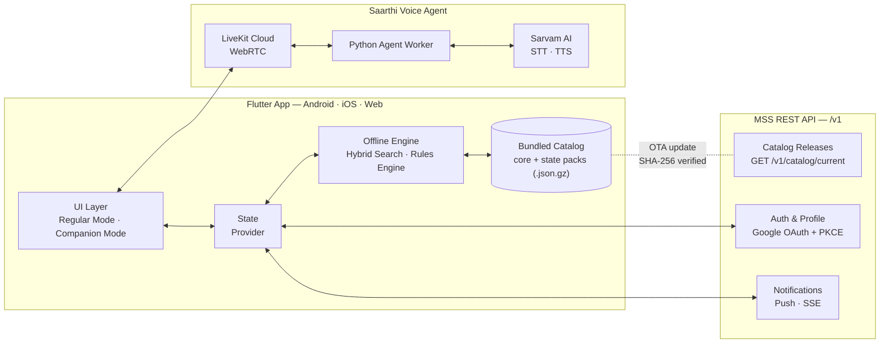
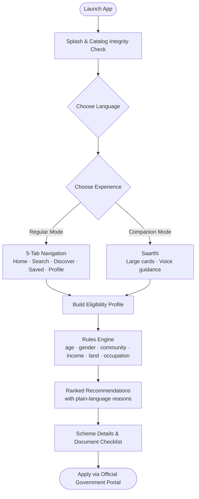
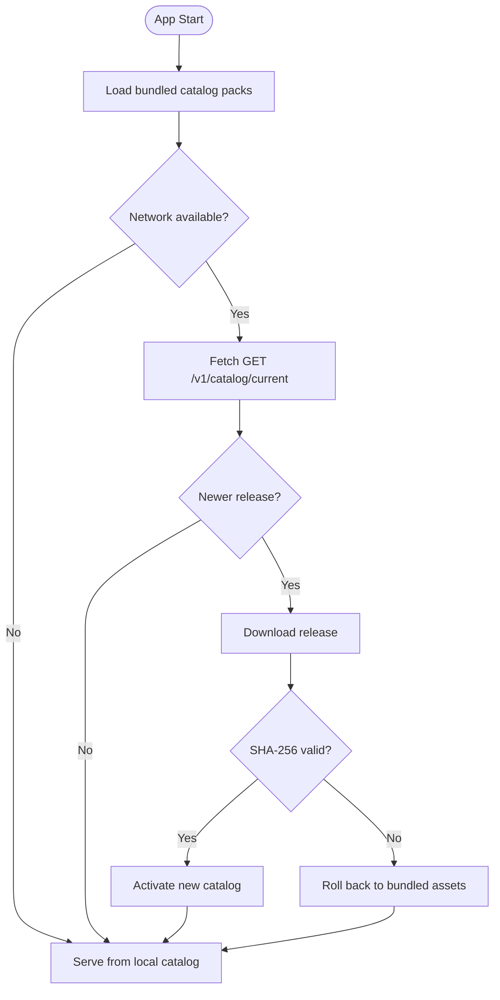
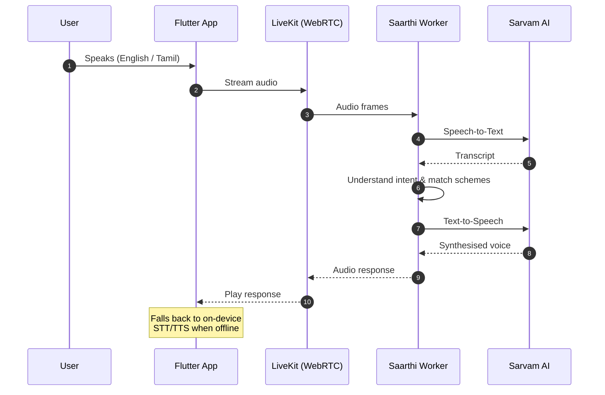

<div align="center">

# MSS — MSME Schemes Search

### AI-powered discovery of Indian Government schemes for entrepreneurs, MSMEs, women and students


**Offline-first** · **Multilingual** · **Explainable eligibility** · **Voice assistant (Saarthi)**

[Overview](#overview) · [Architecture](#system-architecture) · [Features](#key-features) · [Tech Stack](#technology-stack) · [Getting Started](#getting-started) · [Quality Gates](#testing--quality-gates)

</div>

---

## Overview

**MSS** is a multi-platform application that simplifies how citizens find, qualify for and apply to Central and State Government schemes. It bundles a verified catalog of **406 schemes**, evaluates eligibility **on-device** with an explainable rules engine, and offers a **voice-first companion mode** for users who are less comfortable with smartphones.

| | |
|:---|:---|
| **Catalog** | 406 schemes — 274 Central, 53 Tamil Nadu, 79 Maharashtra |
| **Performance** | Sub-250 ms offline queries, zero network calls for search |
| **Localization** | English, Tamil and Hindi (Flutter ARB) |
| **Voice** | Saarthi agent over WebRTC (LiveKit) with Sarvam AI STT/TTS |
| **Privacy** | No telemetry leakage, no DB credentials in the app, bearer-token auth only |

---

## System Architecture



### Monorepo layout

```text
MSS_App/
├── frontend/            # Flutter multi-platform app (Android, iOS, Web)
├── backend/             # REST API references, OpenAPI specs, catalog sources & contracts
├── saarthi-agent/       # LiveKit Python multilingual voice agent worker
├── tools/               # Catalog bundling, seed data and ML evaluation utilities
├── docs/                # Architecture, design system, runbooks and audit logs
└── .github/workflows/   # CI/CD — app build, voice agent CI/deploy, dev log, URL health
```

---

## How It Works

### User journey



### Offline-first catalog sync



### Saarthi voice pipeline



---

## Key Features

<details open>
<summary><b>1. Dual user-experience modes</b></summary>

**Regular Mode** — a modern mobile experience with 5 persistent tabs:

| Tab | What it offers |
|:---|:---|
| **Home** | Personalised recommendations, profile-completion metrics, MSME support widgets, trending announcements |
| **Search** | 300 ms debounced hybrid search, query expansion, multi-attribute filters, instant facet counts |
| **Discover** | State explorer (interactive Tamil Nadu map), central ministries and 7 business calculators |
| **Saved** | Offline bookmarks, recently viewed schemes and cached eligibility assessments |
| **Profile** | Full eligibility profile (personal, location, education, community, business) with Google account sync |

Built-in calculators: Udyam Classifier · Subsidy Estimator · GST · EMI · DPIIT Checklist · Valuation Estimator · Document Checklist.

**Companion Mode (Saarthi)** — a simplified, high-contrast, accessibility-first interface for seniors, first-time smartphone users and rural entrepreneurs:
- Large touch targets with prominent voice prompts
- Full Tamil audio guidance and speech recognition
- Streamlined step-by-step questionnaire

</details>

<details open>
<summary><b>2. Verified offline-first catalog engine</b></summary>

- Core file plus one pack per state in `frontend/assets/catalog/` (`catalog_core`, `catalog_central`, `catalog_tamil_nadu`, `catalog_maharashtra`)
- Sub-250 ms query evaluation with zero network requests
- SHA-256 integrity verification with safe rollback to bundled assets
- Over-the-air catalog updates from `GET /v1/catalog/current` — no app-store release required

</details>

<details open>
<summary><b>3. Explainable eligibility reasoning</b></summary>

- **Deterministic rules engine** evaluating age, gender, community, income ceilings, landholding and occupation criteria offline
- **Explainability** — every recommendation states *why* the user qualifies, in plain language
- **Document checklists** — track prerequisites (Aadhaar, Udyam, Nativity, Income Certificate) with links to official issuing portals

</details>

<details open>
<summary><b>4. Saarthi voice agent</b></summary>

- Real-time conversational assistant in English and Tamil
- Low-latency WebRTC streaming via LiveKit Cloud
- Domain-tuned STT and expressive TTS from Sarvam AI
- On-device speech fallback when offline

</details>

---

## Technology Stack

| Layer | Technologies |
|:---|:---|
| **Frontend** | Flutter 3.44 (Dart 3.11+), Material 3, Provider, Flutter Localizations (ARB) |
| **Backend** | MSS REST API (`api.msmeschemes.org/v1`), Google OAuth with PKCE, Push & SSE notifications |
| **Voice Agent** | Python 3.12+, LiveKit Agents SDK, Sarvam AI voice APIs, `uv` |
| **CI / CD** | GitHub Actions — Flutter analyze/test/build, voice agent lint/test/deploy |

---

## Getting Started

### Prerequisites

| Tool | Version |
|:---|:---|
| [Flutter SDK](https://flutter.dev/docs/get-started/install) | 3.44 stable |
| [Node.js](https://nodejs.org/) | ≥ 20.19.0 |
| [Python](https://www.python.org/) + [`uv`](https://astral.sh/uv) | ≥ 3.10, < 3.15 |

### 1 · Run the Flutter app

```bash
cd frontend
flutter pub get        # install dependencies
flutter analyze        # static analysis — must report 0 issues
flutter test           # full automated test suite
flutter run            # launch on a device or emulator
```

### 2 · Point at a backend

The app uses `https://api.msmeschemes.org` by default. To use another server:

```bash
flutter run --dart-define=API_BASE_URL=http://10.0.2.2:5000
```

`10.0.2.2` is the Android emulator's alias for the host machine. API references live in [`backend/New API Ref/`](backend/New%20API%20Ref/).

### 3 · Run the Saarthi voice agent

```bash
cd saarthi-agent
uv sync --dev                 # install dependencies
uv run ruff check .           # lint
uv run ruff format --check .  # format check
uv run pytest -v              # unit tests
uv run python src/main.py dev # start worker (needs a LiveKit server)
```

---

## Testing & Quality Gates


| Gate | Requirement |
|:---|:---|
| **Static analysis** | `flutter analyze` reports 0 errors and 0 warnings |
| **Design tokens** | `flutter test test/spacing_scale_test.dart` — no hardcoded spacing literals outside `AppSpacing` |
| **Regression suite** | `flutter test` passes 100% |
| **Voice agent** | `ruff` lint/format and `pytest` pass on every change to `saarthi-agent/` |
| **Security** | No secrets committed; the app holds no database credentials and authenticates with a bearer token only |

---

## Documentation

| Document | Description |
|:---|:---|
| [`docs/APP_OVERVIEW.md`](docs/APP_OVERVIEW.md) | Product and app overview |
| [`docs/PRODUCT_DESIGN.md`](docs/PRODUCT_DESIGN.md) | Product design notes |
| [`docs/UI_UX_DESIGN_SYSTEM.md`](docs/UI_UX_DESIGN_SYSTEM.md) | Design system and tokens |
| [`docs/APP_VERSIONING.md`](docs/APP_VERSIONING.md) | Versioning and release rules |
| [`CHANGELOG.md`](CHANGELOG.md) | Release history |

---

## License & Compliance

The source code in this repository is dual-licensed under either of the following, at your option:

- **MIT License** — see [`LICENSE-MIT`](LICENSE-MIT)
- **Apache License, Version 2.0** — see [`LICENSE-APACHE`](LICENSE-APACHE)

Unless you explicitly state otherwise, any contribution intentionally submitted for inclusion in this repository shall be dual-licensed as above, without any additional terms or conditions. Bundled third-party assets (such as fonts under `frontend/assets/fonts/`) keep their own licenses.

All government scheme data bundled in this repository is sourced from verified official Central and State government portals (PIB, Ministry of MSME, Startup India and the Government of Tamil Nadu). Content is intended for public awareness and entrepreneurship enablement.

<div align="center">

<sub>Built for India's entrepreneurs</sub>

</div>
