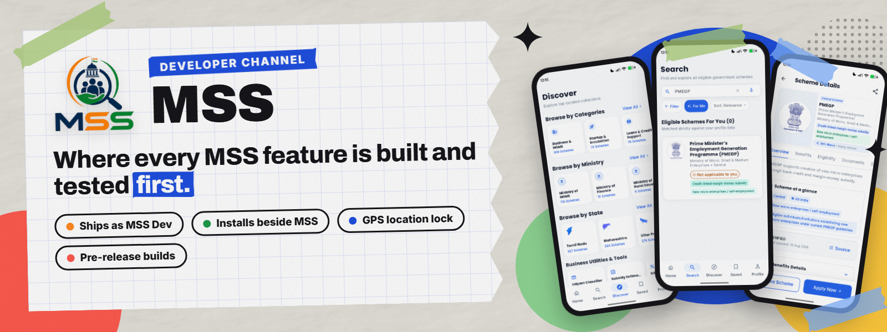
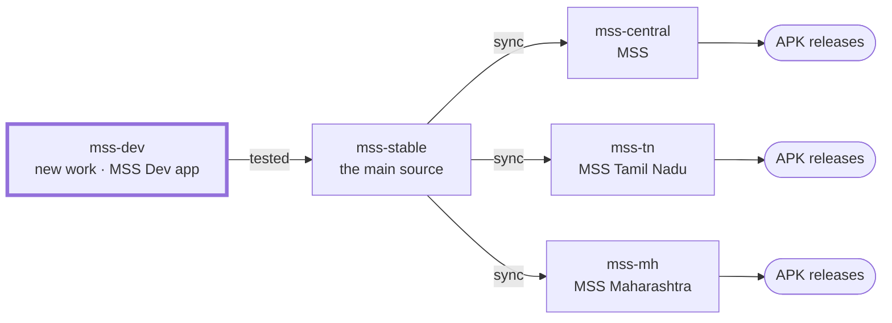

<div align="center">



# MSS Dev

### Where every MSS feature is built and tested first

   

[Overview](#overview) · [The app](#the-dev-app) · [Where it fits](#where-this-repo-fits) · [Workflow](#daily-workflow) · [Build](#building) · [Status](#status)

</div>

---

## Overview

**mss-dev** is where every MSS change starts: new features, fixes, translations and catalog updates. Work is merged here first, tested on real phones through the **MSS Dev** app, and only then promoted to `mss-stable`.

---

## The dev app

| | |
|:---|:---|
| **App name** | MSS Dev |
| **Android app ID** | `com.inschemes.app.dev` — installs beside the normal MSS app |
| **Channel** | `dev` (`MSS_CHANNEL=dev`) |
| **Location lock** | On — the app locks to the state the phone's GPS is in (`MSS_LOCATION_LOCK=true`) |
| **Updates** | Published as pre-releases the in-app updater never offers; the dev app never checks production updates |
| **Who uses it** | The team and testers only |

The dev build, the location lock and the edition switch (Central, Tamil Nadu, Maharashtra) are merged into `main`. Build a dev app of any edition with `--dart-define=MSS_EDITION=<key>`: it gets `.dev` on its app ID and " Dev" on its name.

---

## Where this repo fits



| Repo | Role |
|:---|:---|
| [`mss-dev`](https://github.com/repomssapp-tech/mss-dev) | Daily development. Ships the **MSS Dev** test app. |
| [`mss-stable`](https://github.com/repomssapp-tech/mss-stable) | Tested source. Feeds every edition. |
| [`mss-central`](https://github.com/repomssapp-tech/mss-central) | **MSS** — all-India edition (current app). |
| [`mss-tn`](https://github.com/repomssapp-tech/mss-tn) | **MSS Tamil Nadu** edition. |
| [`mss-mh`](https://github.com/repomssapp-tech/mss-mh) | **MSS Maharashtra** edition. |

---

## Daily workflow

1. Branch from `main`: `feat/...` or `fix/...`.
2. Open a pull request into `main`; CI runs analyze and tests.
3. Merge — CI builds an **MSS Dev** pre-release for testers.
4. When a set of changes is tested, open a pull request from here into `mss-stable`.

---

## Building

```bash
cd frontend
flutter pub get
flutter analyze
flutter test
flutter build apk --release --dart-define=MSS_CHANNEL=dev --dart-define=MSS_LOCATION_LOCK=true
```

Signing needs these repository secrets: `ANDROID_KEYSTORE_BASE64`, `ANDROID_KEYSTORE_PASSWORD`, `ANDROID_KEY_ALIAS`, `ANDROID_KEY_PASSWORD`, `SUPABASE_URL`, `SUPABASE_PUBLISHABLE_KEY`.

---

## Status

| Step | State |
|:---|:---|
| Repo created from MSS_App `main` | ✅ Done |
| Dev build and location lock merged into `main` | ✅ Done |
| Edition switch (central · tn · mh) | ✅ Done ([PR #1](https://github.com/repomssapp-tech/mss-dev/pull/1)) |
| Signing secrets and CI pre-release job | ⏳ Waiting on secrets |
| Firebase app registered for `com.inschemes.app.dev` | ⏳ To do |

---

## Quality gates

| Gate | Requirement |
|:---|:---|
| **Static analysis** | `flutter analyze` reports 0 errors and 0 warnings |
| **Design tokens** | `flutter test test/spacing_scale_test.dart` — no hardcoded spacing outside `AppSpacing` |
| **Regression suite** | `flutter test` passes 100% |
| **Version check** | Every build must have a higher version than the last release, so it installs as an update |
| **Security** | No secrets committed; the app holds no database credentials and authenticates with a bearer token only |

---

## License

The source code is dual-licensed under either of the following, at your option:

- **MIT License** — see [`LICENSE-MIT`](LICENSE-MIT)
- **Apache License, Version 2.0** — see [`LICENSE-APACHE`](LICENSE-APACHE)

Scheme data is sourced from official Central and State government portals and is intended for public awareness and entrepreneurship enablement.

<div align="center">

<sub>Built for India's entrepreneurs · Developer Channel</sub>

</div>
