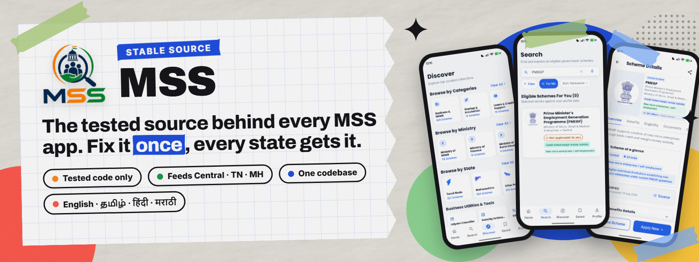
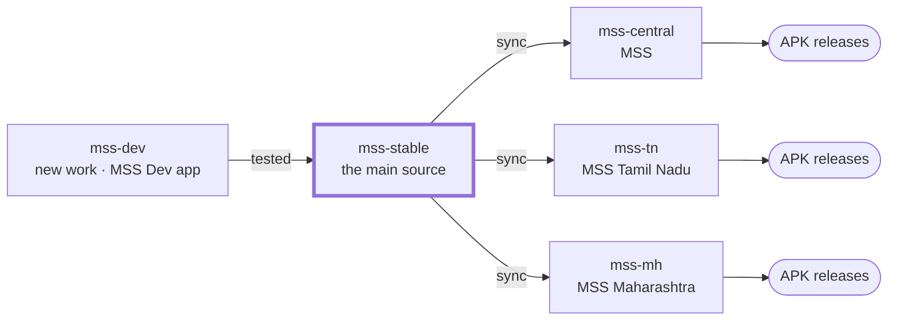

<div align="center">



# MSS Stable

### The tested source behind every MSS app. Fix it once, every state gets it

   

[Overview](#overview) · [Where it fits](#where-this-repo-fits) · [Promoting](#promoting-to-stable) · [Syncing](#syncing-the-editions) · [Rules](#rules-for-this-repo) · [Status](#status)

</div>

---

## Overview

**mss-stable** holds the tested MSS source code — the Flutter app for Android, iOS and the web, its offline scheme catalog (406 schemes: 274 Central, 53 Tamil Nadu, 79 Maharashtra), the eligibility engine and the Saarthi voice assistant.

It does **not** ship an app of its own. Every edition (Central, Tamil Nadu, Maharashtra) is built from this code plus its own settings, so a fix made once reaches every state.

---

## Where this repo fits



| Repo | Role |
|:---|:---|
| [`mss-dev`](https://github.com/repomssapp-tech/mss-dev) | Daily development. Ships the **MSS Dev** test app. |
| [`mss-stable`](https://github.com/repomssapp-tech/mss-stable) | Tested source. Feeds every edition. |
| [`mss-central`](https://github.com/repomssapp-tech/mss-central) | **MSS** — all-India edition (current app). |
| [`mss-tn`](https://github.com/repomssapp-tech/mss-tn) | **MSS Tamil Nadu** edition. |
| [`mss-mh`](https://github.com/repomssapp-tech/mss-mh) | **MSS Maharashtra** edition. |

---

## Promoting to stable

Code reaches `mss-stable` only from `mss-dev`, after it has passed testing:

1. The change is merged and tested in `mss-dev` (MSS Dev app on test phones).
2. A pull request from `mss-dev` into `mss-stable` `main`.
3. All quality gates pass, then merge.

## Syncing the editions

After a merge here, the same commits are synced into `mss-central`, `mss-tn` and `mss-mh`. The code in every edition repo is identical to this repo; each one only differs in its README, banner and the `MSS_EDITION` repository variable that picks which app CI builds.

---

## Rules for this repo

1. **No direct pushes** — changes arrive by pull request from `mss-dev`.
2. **No scattered edition checks** — everything that differs between editions lives in [`frontend/lib/config/edition.dart`](frontend/lib/config/edition.dart), not in `if (state == ...)` branches across the app.
3. **Every merge must pass** the quality gates below.

---

## Getting started

```bash
cd frontend
flutter pub get        # install dependencies
flutter analyze        # must report 0 issues
flutter test           # full automated test suite
flutter run            # launch on a device or emulator
```

---

## Status

| Step | State |
|:---|:---|
| Repo created from MSS_App `main` | ✅ Done |
| Edition switch (central · tn · mh) | ✅ Done |
| First promotion from `mss-dev` and sync to the editions | ✅ Done |
| Automated promote-and-sync workflow | ⏳ To do |
| Branch protection on `main` | ⏳ To do |

---

## Quality gates

| Gate | Requirement |
|:---|:---|
| **Static analysis** | `flutter analyze` reports 0 errors and 0 warnings |
| **Design tokens** | `flutter test test/spacing_scale_test.dart` — no hardcoded spacing outside `AppSpacing` |
| **Regression suite** | `flutter test` passes 100% |
| **Version check** | Every build must have a higher version than the last release, so it installs as an update |
| **Security** | No secrets committed; the app holds no database credentials and authenticates with a bearer token only |

---

## License

The source code is dual-licensed under either of the following, at your option:

- **MIT License** — see [`LICENSE-MIT`](LICENSE-MIT)
- **Apache License, Version 2.0** — see [`LICENSE-APACHE`](LICENSE-APACHE)

Scheme data is sourced from official Central and State government portals and is intended for public awareness and entrepreneurship enablement.

<div align="center">

<sub>Built for India's entrepreneurs · Stable Source</sub>

</div>
