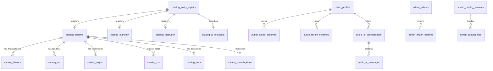

# Supabase Database Architecture & Technical Reference (v2.1)

> **Generated:** 2026-08-05, updated 2026-09-04 after the Aug 18 -- Sep 4 security-hardening
> migration series was reconciled onto the live project (see §4).
> **Database Engine:** PostgreSQL (Supabase)
> **Architecture Scope:** Hybrid Relational + JSONB Offline-Sync
> **Source of truth:** `backend/supabase/migrations/`. `backend/supabase/schema.sql` is a
> point-in-time `supabase db dump` snapshot of the live project for reference/diffing --
> regenerate it, don't hand-edit it.

---

## 1. Executive Summary & Design Principles

The **IN Schemes** database is organized to support citizen scheme searches and administrative governance. The system operates on the following core principles:

1. **Schema Partitioning:**
   - `catalog`: Contains all government catalog data, structured for offline compilation and search optimization.
   - `public`: Stores client/user application state (profiles, saved items, chat histories).
   - `admin`: Manages publishing workflows, translations, change audits, and RBAC security.
   - `private`: Secure internal database utilities, membership scopes, and audits.
2. **Hybrid Relational + JSONB Catalog Data:**
   - To combine the flexibility of document-oriented schemas with high-performance querying, catalog tables store the full canonical document in a `record_json` column.
   - Critical search and filter parameters (e.g. `name_en`, `name_ta`, `government_level`, `max_funding_amount`) are mirrored in indexed relational columns.
3. **Mostly triggerless, with one deliberate exception:**
   - Compilation and serialization are still handled asynchronously by an application-level **Catalog Service**, keeping the database mostly free of complex lock conditions.
   - The one exception: `catalog.*` row `checksum` is kept in sync with `record_json` by a `BEFORE INSERT OR UPDATE` trigger (`catalog.mss_recompute_row_checksum()`, added 2026-09-04). Before this, `checksum` was only ever set by the Node import pipeline -- a direct Table Editor edit to `record_json` silently left `checksum` stale, corrupting `public.mss_catalog_meta()`'s drift-detection aggregate. The trigger closes that gap at the DB layer so it can't recur regardless of how a row gets written.
4. **Defense-in-depth RLS, not just app-layer checks (see §5):**
   - Every RLS-enabled table must carry at least one policy (enforced by a recurrence guard, `private.rls_coverage_violations()`), `FORCE ROW LEVEL SECURITY` is set on the PII/RBAC table set so even a `SECURITY DEFINER` bug can't silently bypass RLS, and a weekly CI job re-checks the live project (dashboard edits don't go through migrations, so this is the real enforcement point for drift).

---

## 2. Entity-Relationship Diagram (ERD)

---

## 3. Comprehensive Schema & Table Specifications

### 3.1. `catalog` Schema

#### Table: `catalog.entity_registry`
* **Description:** Global index of all catalog items across all categories for validation, tracking, and soft-deletes.
* **Columns:**
  - `entity_id` `TEXT` (PK) - Stable ID.
  - `entity_type` `TEXT` - e.g. `'scheme'`, `'authority'`, `'institution'`.
  - `catalog_name` `TEXT` - e.g. `'scheme_catalog'`.
  - `current_version` `TEXT` - Record version.
  - `status` `TEXT` - `'DRAFT'`, `'READY_FOR_REVIEW'`, `'REVIEWED'`, `'APPROVED'`, `'PUBLISHED'`, `'ARCHIVED'`.
  - `validation_status` `TEXT` - `'PASSED'`, `'FAILED'`, `'WARNING'`, `'NOT_VALIDATED'`.
  - `is_deleted` `BOOLEAN`.
  - `deleted_at` `TIMESTAMPTZ`.
  - `deleted_reason` `TEXT`.
  - `updated_at` `TIMESTAMPTZ`.

#### Table: `catalog.scheme`
* **Description:** Government financial and assistance support schemes master database.
* **Relational Columns:**
  - `scheme_code` `TEXT` (Unique) - Reference code (e.g. `'IN001'`).
  - `name_en` `TEXT` - English scheme name.
  - `name_ta` `TEXT` - Tamil scheme name.
  - `government_level` `TEXT` - e.g. Central / State / District.
  - `ministry` `TEXT` - UNION Ministry name.
  - `department` `TEXT` - Issuing department.
  - `state` `TEXT` - Target geographic state.
  - `scheme_type` `TEXT` - e.g. Grant / Subsidy / Loan.
  - `max_funding_amount` `NUMERIC(15,2)`.
  - `minimum_funding_amount` `NUMERIC(15,2)`.
  - `is_active` `BOOLEAN` - Match availability indicator.
  - `search_keywords` `TEXT`.

#### Table: `catalog.authority`
* **Description:** Administrative and government ministries or state-level overseeing bodies.
* **Columns:**
  - `code` `TEXT` (Unique) - Authority unique code.
  - `name_en` `TEXT`.
  - `name_ta` `TEXT`.

#### Table: `catalog.institution`
* **Description:** Specific implementing bodies or departments (e.g., SIDBI, NABARD).
* **Columns:**
  - `code` `TEXT` (Unique).
  - `name_en` `TEXT`.
  - `name_ta` `TEXT`.
  - `authority_id` `TEXT` (FK -> `catalog.authority(id)`).

#### Table: `catalog.finance`
* **Description:** Detail finance structures and credit incentives mapping to schemes.
* **Columns:**
  - `scheme_id` `TEXT` (FK -> `catalog.scheme(id)`).
  - `interest_subvention_rate` `NUMERIC(5,2)`.
  - `max_loan_amount` `NUMERIC(15,2)`.

#### Table: `catalog.tax`
* **Description:** Direct/indirect tax exemptions and subventions.
* **Columns:**
  - `scheme_id` `TEXT` (FK -> `catalog.scheme(id)`).
  - `exemption_percentage` `NUMERIC(5,2)`.

#### Table: `catalog.export`
* **Description:** Export subsidies, duty-drawbacks, and international trade assistance.
* **Columns:**
  - `scheme_id` `TEXT` (FK -> `catalog.scheme(id)`).
  - `target_countries` `TEXT[]`.

#### Table: `catalog.csr`
* **Description:** Corporate Social Responsibility grants and focus areas.
* **Columns:**
  - `scheme_id` `TEXT` (FK -> `catalog.scheme(id)`).
  - `focus_areas` `TEXT[]`.

#### Table: `catalog.treds`
* **Description:** Platform mappings for Trade Receivables Discounting System.
* **Columns:**
  - `scheme_id` `TEXT` (FK -> `catalog.scheme(id)`).
  - `interest_rate_range` `TEXT`.

#### Table: `catalog.search_index`
* **Description:** Content text chunks alongside 1536-dimensional embeddings.
* **Columns:**
  - `scheme_id` `TEXT` (Unique FK -> `catalog.scheme(id)`).
  - `content` `TEXT`.
  - `embedding` `extensions.vector(1536)` - OpenAI vectors.

#### Table: `catalog.relationships`
* **Description:** Dynamic, typed dependency graph mapping between registry entities.
* **Columns:**
  - `id` `UUID`.
  - `source_type` `TEXT`.
  - `source_id` `TEXT`.
  - `target_type` `TEXT`.
  - `target_id` `TEXT`.
  - `relationship_type` `TEXT` - e.g. `'depends_on'`, `'requires_service'`.

#### Table: `catalog.ai_metadata`
* **Description:** AI-generated metadata, translations, and summaries.
* **Columns:**
  - `entity_id` `TEXT` (PK -> `catalog.entity_registry(entity_id)`).
  - `summary_en` `TEXT`.
  - `summary_ta` `TEXT`.
  - `keywords` `TEXT[]`.
  - `embedding_status` `TEXT`.
  - `approved` `BOOLEAN`.

#### Tables added by the `catalog_parity_closure` migration (2026-08-17)
Same shape as the tables above (`id`, `version`, `status`, `checksum`, `record_json`, plus a few mirrored relational columns) -- added to close a gap where 5 of the 15 source catalog files had no DB table at all:
* `catalog.applicability_matrix` -- `scheme_id`, `government_level`, `department_authority_id`, `sector_text`, `district_text`.
* `catalog.enterprise_classification` -- `code`, `dimension`, `investment_max_inr`, `turnover_max_inr`.
* `catalog.msme_privilege` -- `privilege_type`, `statute`.
* `catalog.business_enablement` -- `enablement_type`, `provider_authority_id`, `online_url`.
* `catalog.cluster_assistance` -- `cluster_name`, `sector`, `administering_authority_id`.

All 16 `record_json`-carrying `catalog.*` tables (the above 5 plus the ten in §3.1) are covered by the row-checksum trigger described in §1.3 and aggregated by `public.mss_catalog_meta()`.

---

### 3.2. `public` Schema

#### Table: `public.profiles`
* **Description:** Individual user account preferences and demographics.

#### Table: `public.startup_profiles`
* **Description:** Venture details, sector, development stage, and target requirements.

#### Table: `public.saved_schemes`
* **Description:** Citizen user favorites list mapping to `catalog.scheme(id)`.

#### Table: `public.recent_schemes`
* **Description:** Audit-log of recently viewed schemes.

#### Table: `public.ai_conversations` / `public.ai_messages`
* **Description:** Thread and message records for natural language search helpers.

#### Table: `public.sync_history`
* **Description:** Synchronization logs submitted by client apps.
* **Columns:**
  - `id` `UUID`.
  - `user_id` `UUID` (FK -> `public.profiles(id)`).
  - `device_id` `TEXT`.
  - `platform` `TEXT`.
  - `previous_release_version` `BIGINT`.
  - `synced_release_version` `BIGINT`.
  - `status` `TEXT` - `'SUCCESS'`, `'FAILED'`.
  - `error_message` `TEXT`.
  - `duration_ms` `INTEGER`.

#### Table: `public.chat_logs`
* **Description:** Write-only telemetry sink for the saarthi-agent voice/chat assistant -- one row per conversation turn (`conversation_uid`, `turn_index`, `mode` voice/text, `user_message`, `ai_message`, `metadata`). Not the user-facing chat store (that's `ai_conversations`/`ai_messages` above, with real own-row RLS). Formally captured into a migration and locked down 2026-08-28/09-01 (see §5.2) after being found world-readable via the app's own anon key.

#### Table: `public.api_rate_limits`
* **Description:** Persistent, race-safe backing store for `public.mss_check_rate_limit()` -- an atomic `INSERT ... ON CONFLICT DO UPDATE` per `(bucket, identifier)` sliding window, with opportunistic GC on ~1% of calls. `service_role`-only by design (RLS enabled, deliberately zero client policies -- see §5.1). Replaces an earlier in-memory-only limiter that didn't survive Edge Function cold starts.

#### Other `public.*` tables (brief)
* `public.questionnaire_sessions` / `public.user_responses` / `public.recommendations` -- onboarding questionnaire flow and its derived recommendations, own-row RLS via `startup_profiles.user_id`.
* `public.questions` / `public.question_options` -- static questionnaire content, public read.
* `public.notifications`, `public.feedback`, `public.search_logs`, `public.bug_reports`, `public.feature_requests` -- app telemetry/support tables, authenticated-only read (tightened 2026-09-01, see §5.2).
* `public.organizations`, `public.organization_memberships`, `public.roles`, `public.user_roles`, `public.regions`, `public.user_regions`, `public.departments`, `public.beneficiary_categories`, `public.audit_log` -- an admin/RBAC subsystem (distinct from the `admin.*` schema's publishing-pipeline RBAC) gated by the `private.has_role()` / `private.belongs_to_organization()` helper functions.

> `public.auth_user_id` (a 1-column, no-PK/FK table with no migration and no code reference) existed on the live project from before this reconciliation. Inspected 2026-09-04: exactly 1 orphaned row not matching any current profile, RLS-enabled with zero policies (unreadable regardless). Confirmed dead and dropped.

---

### 3.3. `admin` Schema

#### Table: `admin.roles` / `admin.admins`
* **Description:** Role-Based Access Control (RBAC) mapping staff members to scopes.

#### Table: `admin.import_batches`
* **Description:** Logs catalog import operations (e.g., JSON imports from LLMs/Claude).

#### Table: `admin.catalog_releases`
* **Description:** Immutable release manifestations targeting specific app schema versions.

#### Table: `admin.catalog_files`
* **Description:** Specific catalog parts (e.g. `scheme_catalog.json`) generated in a release, tracking compression and mime types.

#### Table: `admin.translation_jobs` / `admin.translation_memory`
* **Description:** Asynchronous localization tasks and translation memories for high-speed catalog localization.

#### Table: `admin.record_locks`
* **Description:** CMS lockouts preventing admins from overwriting concurrent edits.

#### Table: `admin.job_queue`
* **Description:** Generic background execution queue.

#### Table: `admin.event_log`
* **Description:** Audit ledger tracking administrative updates.

---

## 4. Migration/live drift reconciliation (2026-09-04)

Between 2026-08-18 and 2026-09-01, an entire security-hardening migration series (16 files) was written and committed to this repo but was **never actually applied to the hosted project** -- the CLI's migration-history ledger and the live database had diverged in both directions: local-only migrations that never got pushed, and out-of-band dashboard/table-editor changes that got recorded in the ledger with no matching local file. Confirmed live impact while unresolved: `public.chat_logs` (conversation logs, including profile PII surfaced in agent prompts) was readable by any unauthenticated caller holding the app's public API key.

Reconciled 2026-09-04: the 9 out-of-band ledger entries were marked `reverted` (bookkeeping only), a handful of the pending migrations were fixed to be properly idempotent against the live drift they were colliding with, and all 16 were pushed. `backend/supabase/schema.sql` is the resulting confirmed-live snapshot. Going forward, prefer `supabase db push --linked` regularly over letting migrations queue up, and treat `supabase migration list --linked` (local vs. remote columns) as the drift check before assuming any migration file reflects live reality.

## 5. Security Posture

### 5.1. RLS coverage & FORCE RLS
Every RLS-enabled table across `public`/`catalog`/`admin` must carry at least one policy, or it silently becomes unreadable/unwritable to `anon` and `authenticated` alike (a `zero-policy` state has caused real, confirmed drift twice -- see §4). This is enforced by `private.rls_coverage_violations()`, called two ways: at migration time (`raise warning`, non-blocking) and by `.github/workflows/rls-drift-check.yml` weekly against the live project (hard-fails, opens an issue -- the real enforcement point, since dashboard edits never go through a migration run). The function also flags `profiles` SELECT drifting back to `anon`/`PUBLIC`/`USING(true)`, any sensitive `public.*` table gaining an anon-readable policy, RLS disabled outright on a base table, and missing `FORCE ROW LEVEL SECURITY` on the PII/RBAC set.

`FORCE ROW LEVEL SECURITY` is set on `profiles`, `startup_profiles`, and the `organizations`/`organization_memberships`/`roles`/`user_roles`/`regions`/`user_regions`/`departments`/`beneficiary_categories` RBAC set -- so even a table-owner-context bug (a future `SECURITY DEFINER` function or trigger mistake) fails closed instead of silently bypassing RLS. Deliberately excluded: `admin.*` and `catalog.*` (owner-context bulk import/publish jobs need the table-owner bypass) and `public.audit_log` (append-only, no known non-definer writer yet).

### 5.2. What got locked down
* `public.chat_logs` -- `anon` had full `SELECT`/`INSERT` via `USING(true)`/`WITH CHECK(true)` policies plus table-level grants; now `authenticated`-only `INSERT`, no client `SELECT` at all, `service_role` (Edge Functions/analytics) unaffected.
* `public.profiles` -- residual table-level grants to `anon` revoked (the tightened self-row SELECT policy had landed in an earlier migration, but the accompanying `revoke` had not -- same "recorded as applied, absent live" class of drift as §4).
* `public.promo_alerts` / `public.feature_requests` -- `anon` read revoked, `authenticated`-only.
* `catalog.relationships` -- reads gated on the *source* entity being `PUBLISHED` (a published scheme can still incidentally reveal a draft target entity's name via `mss_relationships()` -> `mss_entity_record()`; flagged, not yet closed).
* Storage: the `catalogs` bucket was `public: true` with a blanket bucket-wide read policy -- 675 unauthenticated requests for one file would drain the entire monthly egress allowance. Now private; clients may read exactly `releases/<version>/catalog_bundle.json.gz` and nothing else.
* `public.mss_current_release()`, `public.mss_scheme_detail()` and the other RPC-layer functions listed in §3 are all `SECURITY DEFINER` with a pinned `search_path` (no search-path-hijack surface); the remaining `SECURITY INVOKER` catalog functions (`mss_search`, `mss_localized_text`, `mss_search_document`) got their `search_path` pinned too, for hygiene.
* `functions.v1` (the Edge Function surface) runs with `verify_jwt = true`, pinned in `config.toml` with an explicit comment against silent regression -- previously it ran with `verify_jwt = false`, meaning every `/v1/*` route was invokable with no credential at all.

### 5.3. Known open items (not yet fixed)
* `catalog.mss_scheme_detail()`/`mss_lookup_catalog()`/etc. don't filter `status = 'PUBLISHED'` in the SQL body itself -- only at the GRANT layer (`service_role`-only). Safe today, but not fail-safe if an Edge Function forgets to filter.
* Missing indexes on several FK/RLS-filter columns (`catalog.finance/tax/export/csr/treds.scheme_id`, and the `user_id`/`conversation_id` columns most `public.*` RLS policies filter on).
* `publishCatalog` Edge Function has no admin/service-role check -- any authenticated user can trigger a `catalog_updated` realtime broadcast.
* `search` Edge Function has no DB-backed rate limiting (unlike `v1`, which uses `mss_check_rate_limit()`/`api_rate_limits`).
