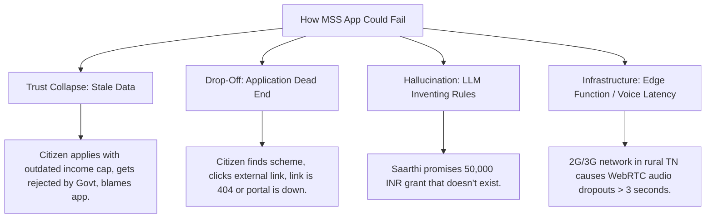

# gstack-plan-ceo-review: MSS Strategic Founder & CEO Review

**Date:** August 27, 2026  
**Reviewer:** gstack CEO / Founder Reviewer  
**Product:** MSS App (My Scheme Search / IN Schemes)  
**Operating Mode:** SELECTIVE EXPANSION (Rigorous baseline + high-leverage strategic expansions)  
**Output Path:** `security_fixes/gstack-plan-ceo-review.md`

---

## 1. The 10-Star Product Vision

### The Problem
India has over 3,000 central and state welfare schemes with trillions of rupees budgeted annually. Yet, **over 60% of eligible citizens never claim their benefits**. Why?
1. **Information Asymmetry:** Scheme guidelines are buried in 40-page administrative government orders (GOs) written in dense legalese.
2. **Eligibility Ambiguity:** Citizens do not know if their specific combination of age, community, income, and occupation qualifies them.
3. **Application Paralysis:** Even when a citizen discovers a scheme, they fail at the documentation stage (missing community certificate, unverified land record, lack of Udyam registration).

### The 1-Star to 10-Star Experience Spectrum

| Tier | User Experience |
|---|---|
| **1-Star** | A static PDF directory of Tamil Nadu government schemes hosted on an obscure government portal with broken search. |
| **3-Star** | A standard web portal with keyword search, but no personalized eligibility filtering. |
| **5-Star** | A mobile app where users enter age, income, and community to receive a list of matching scheme cards with official external links. *(Where MSS is today)* |
| **7-Star** | A bilingual voice assistant in Tamil and Tanglish that interviews the citizen in 60 seconds, handles dialect variations, highlights top 3 high-impact schemes, and tells them exactly what 2 documents they are missing. |
| **10-Star** | **"The Sovereign Benefit Butler"**: The citizen speaks to Saarthi for 2 minutes or scans their family ration card / Aadhaar with OCR. MSS verifies eligibility across 1,000+ schemes instantly, auto-generates the filled application form, interfaces with DigiLocker / e-Sevai API to pull certificates with explicit DPDPA consent, alerts when application deadlines are 48 hours away, and notifies the citizen when benefit funds are credited to their DBT account. |

---

## 2. Premise Challenge & The Strategic Wedge

### Challenge: Is "Search & Discovery" the Real Bottleneck?
- **The Hard Truth:** Finding the name of a scheme is not what changes a citizen's life. **Disbursement of the subsidy or welfare benefit is what changes their life.**
- If MSS stops at "Here is the scheme name and link", user drop-off at the external portal will exceed 85%.
- **The Pivot:** MSS must evolve from a *search catalog* into an **Application Navigator & Readiness Engine**. The killer feature is not just finding TN001 (Micro Manufacturing Capital Subsidy); it is the **Missing Document Checklist** that tells the user: *"You have 4 of 5 required documents. Tap here to get your Udyam Certificate in 10 minutes on your phone."*

### The Desperate Specificity: Tamil Nadu First
Tamil Nadu is the ideal beachhead market for three reasons:
1. **Pioneering Digital Governance:** TN e-Sevai, TNeGA, and StartupTN have high API readiness compared to other states.
2. **High Welfare Penetration:** High welfare spend across women entrepreneurs (PMEGP, NEEDS, UYEGP), education scholarships (Pudhumai Penn), and agrarian subsidies.
3. **Linguistic Pride & Voice Adoption:** Voice-first interaction in natural Tamil/Tanglish completely bypasses literacy barriers in Tier 2/3 districts (Dharmapuri, Tirunelveli, Ramanathapuram).

---

## 3. Cognitive Patterns: CEO-Level Evaluation

### 3.1. Classification Instinct: One-Way vs. Two-Way Doors
- **One-Way Doors (Reversible only with catastrophic cost):**
  - **Citizen PII & Demographic Data Architecture:** Storing caste/community, income, and religion requires strict DPDPA compliance, zero anonymous reads, and immutable consent logs. If breached, trust is permanently destroyed. *(Remediated in Phase 1 fixes).*
  - **LiveKit / AI Model Vendor Lock-in:** Choosing Sarvam AI (`saaras:v3`, `sarvam-105b`, `bulbul:v3`) as the voice stack must be abstracted behind an adapter pattern so alternative Indian voice models (Bhashini, AI4Bharat) can be plugged in without rewriting client engines.
- **Two-Way Doors (High reversibility, move fast):**
  - UI layout tweaks, card styling, home banner carousels, and question ordering in the onboarding wizard.

### 3.2. Focus as Subtraction (What to Kill)
1. **Kill the Pre-Onboarding "Navigation Mode Fork":** Stop forcing users to pick "Regular Mode" vs "Companion Mode" on launch. It adds mental friction before delivering any value. Deliver the unified dashboard with Saarthi ambiently available.
2. **Kill Exhaustive Profile Form Fields:** Remove optional fields like "Industry Sub-sector" and "Annual Family Electricity Bill" from early onboarding. Collect them lazily only when a specific scheme requires them.
3. **Kill Unverified Third-Party Scheme Aggregators:** Rely strictly on verified government Gazettes, official ministry datasets, and direct TNeGA feeds. High accuracy beats high volume.

### 3.3. Inversion Reflex (What Causes MSS to Fail?)

**Countermeasures Implemented & Planned:**
1. **Automated Scheme Verifier Pipeline:** Nightly headless crawler verifying that external government application URLs return HTTP 200 and scheme codes match active notifications.
2. **Strict LLM Grounding:** Saarthi voice assistant is strictly forbidden from hallucinating schemes: instructions mandate that `find_schemes` tool output is the sole source of truth.
3. **Offline Audio Fallback:** If WebRTC audio stalls, client automatically switches to streaming text responses over lightweight HTTP.

---

## 4. Failure Modes & Observability Directives

Every data flow must account for its three shadow paths:

### 4.1. The Citizen Search Flow Shadow Paths
1. **Happy Path:** Citizen enters profile -> MSS matches 4 schemes -> Citizen clicks "Application Guide" -> Lands on verified e-Sevai portal.
2. **Shadow Path 1 (Zero Matches):** Citizen's income is above threshold or age does not qualify.
   - *Failure:* Empty screen stating "No schemes found". (Depletes user goodwill).
   - *Fix:* Display "Near-Match Schemes": *"You missed Scheme TN042 by only 10,000 INR annual income. Here are 3 general business development subsidies that have no income limit."*
3. **Shadow Path 2 (Network Disconnect Mid-Voice Session):**
   - *Failure:* Voice agent hangs silently.
   - *Fix:* Local Flutter audio state detector displays animated banner: *"Voice connection paused. Your details are saved. Tap to resume or read results below."*
4. **Shadow Path 3 (Upstream AI Provider Latency Spike):**
   - *Failure:* Sarvam LLM takes > 4 seconds to generate spoken Tamil reply.
   - *Fix:* Immediate acoustic filler ("ஒரு நிமிடம் சரிபார்க்கிறேன்..." - *Checking in a moment...*) spoken by client TTS within 600ms while waiting for tool response.

---

## 5. Actionable Scope Directives

### Directives for Scope Expansion (Recommended for Q4 2026):
1. **DigiLocker / Aadhaar Consent Integration:** Allow authenticated citizens to pull their verified Nativity and Community certificates with 1 click, eliminating manual document entry.
2. **Push Notification Deadline Radar:** Track application closing dates for high-demand schemes (e.g. NEEDS subsidy cycle) and alert matching citizens 7 days prior.
3. **Panchayat / Common Service Centre (CSC) Operator Mode:** Allow local village VLEs (Village Level Entrepreneurs) to use MSS on their tablets to assist dozens of rural citizens under a managed operator profile.

### Directives for Scope Reduction (Immediate):
1. Strip all non-essential profiling questions from the initial splash/login flow.
2. Defer multi-state expansion (beyond Tamil Nadu and Central Govt) until the TN scheme conversion funnel hits a 40% completion rate.

---

## 6. Executive Verdict

MSS possesses exceptional market timing: aligning India's Digital Public Infrastructure (DPI) with citizen welfare accessibility. By shifting focus from pure search to **application readiness**, and safeguarding trust through flawless security and accurate eligibility logic, MSS has the potential to become the default welfare gateway for 80+ million citizens in Tamil Nadu and hundreds of millions across India.
