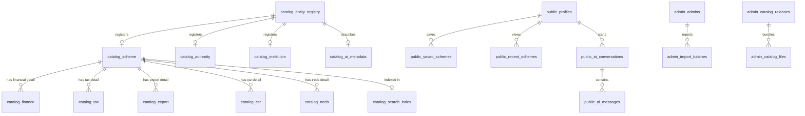

# MSS Backend Architecture, Decisions & Product Requirements Specifications

**Audience:** Backend engineers, database administrators, and system architects maintaining the MSS Supabase backend, migration lifecycle, and search/MLOps pipelines.

## Table of Contents
1. [Part 1: Architecture Decision Records (ADRs)](#part-1-architecture-decision-records-adrs)
   - [ADR 0001: Backend Governance Baseline](#adr-0001-in-schemes-backend-governance-baseline)
   - [ADR 0002: Migrations as Source of Truth](#adr-0002-migrations-as-source-of-truth-and-schema-regeneration-discipline)
2. [Part 2: Core Backend Product Requirements Document (PRD)](#part-2-core-backend-product-requirements-document-prd)
3. [Part 3: Backend Search, Taxonomy & MLOps PRD](#part-3-backend-search-taxonomy--mlops-prd)
4. [Part 4: Supabase Database Architecture & Technical Reference](#part-4-supabase-database-architecture--technical-reference)

---

# Part 1: Architecture Decision Records (ADRs)

## ADR 0001: IN Schemes backend governance baseline

# ADR 0001: IN Schemes backend governance baseline

- Status: Proposed; engineering scaffold adopted, product defaults pending
- Date: 2026-07-21
- Source: `BACKEND_ONLY_PRD.md` version 1.0

## Context

The existing IN Schemes repository already contains a Flutter client, Supabase
schema, and public recommendation APIs. The next backend milestones depend on a
repeatable Supabase environment, a reviewable administration API contract, and
explicit answers to the open product decisions in PRD section 16.

## Engineering decisions adopted now

1. Supabase PostgreSQL is the only writable system of record.
2. Database changes are forward-only timestamped migrations. A mitigation note
   is required for destructive or irreversible migrations.
3. The Supabase CLI is pinned as a project dependency and run through npm.
4. Database invariants and RLS boundaries are tested with pgTAP.
5. API endpoints use `/v1`, bearer authentication, a stable error envelope,
   request IDs, and idempotency keys for retryable commands.
6. Privileged database functions use `security definer`, `search_path = ''`,
   fully qualified names, explicit authorization, and explicit execution grants.
7. Dates without a time retain local-date semantics; timestamps use UTC.

## Proposed MVP defaults requiring stakeholder confirmation

These values unblock design but are not product commitments:

| Decision | Proposed default | Consequence if changed |
|---|---|---|
| Organization model | One operating organization initially; schema remains tenant-aware | Minimal migration if a second agency is added |
| Region hierarchy | Generic state/district/block/village tree with stable government codes | Seed/import mapping changes, not core schema |
| Region overlap | A revision may target multiple regions | Required for schemes spanning administrative boundaries |
| Admin experience | Complete administration API; no web UI in initial scope | UI can be added without changing backend contracts |
| Spoken variants | Formal Tamil, colloquial Tamil, and Tanglish | Additional language/script codes remain extensible |
| Delta retention | 90 days | Impacts storage, cursor expiry, and snapshot frequency |
| Audit retention | Seven years, subject to policy/legal review | Impacts partitioning and archival operations |
| Expected launch load | Must be supplied before Sprint 3 load-test design | Prevents credible capacity sign-off today |

## Delivery sequence

1. Identity, roles, regions, taxonomies, and their complete adversarial RLS matrix.
2. Stable schemes and immutable revision content model.
3. Review/publication/withdrawal transactions and audit events.
4. Signed cursor delta sync and bounded snapshots.
5. Idempotent CSV/JSON imports.
6. Storage policies, observability, security hardening, and operational runbooks.

## Review gates before Sprint 1 closes

- Confirm all proposed product defaults above.
- Supply authoritative region codes and representative scheme/source files.
- Approve required scheme fields and beneficiary categories.
- Name the owners for Tamil review, publication, emergency correction, and
  withdrawal.
- Create separate development, staging, and production Supabase projects.

---

## ADR 0002: Migrations as source of truth and schema regeneration discipline

# ADR 0002: Migrations are the source of truth for the database

- Status: Accepted
- Date: 2026-09-02
- Supersedes: none
- Related: ADR 0001 (engineering decision 2 — forward-only timestamped migrations)

## Context

Schema, grant, RLS-policy, and `security definer` function changes have been
applied to the live Supabase project by hand (Supabase CLI and the Studio SQL
editor). Several migration headers record fixes that were "marked applied in
`schema_migrations` but absent live"
(`20260818000000_restore_orphaned_rls_policies.sql`,
`20260901000000_lockdown_chat_logs_and_profiles_anon.sql`,
`20260901000200_reconcile_orphan_tables.sql`). A full-PII anon-readable policy
on `public.profiles` was live as recently as 2026-08-27. Dashboard SQL edits
bypass `supabase db reset` and the `backend-database.yml` CI job, so drift is
invisible until an audit or the weekly `rls-drift-check.yml` job finds it.

## Decision

1. The timestamped files in `backend/supabase/migrations/` are the authoritative
   definition and complete change history of the database. Anything not
   represented by a committed migration is not part of the schema.
2. Direct SQL against any hosted project (Studio SQL editor, `psql`, ad-hoc
   scripts) is not a source of truth. It is permitted only for read-only
   inspection and for documented emergency response; an emergency change must be
   captured as a migration in the same working day.
3. Every production database change — schema, grant, RLS policy, function,
   trigger, extension — ships as a forward-only migration through the normal
   review and CI path. No exceptions for "small" changes.
4. Before a deployment that depends on the database, the live project is
   reconciled against the migration set: run `supabase db reset` on a
   non-production project from migrations, `supabase db diff` it against the
   target, and fold any live-only drift back into a migration. The
   `rls-drift-check.yml` workflow (which fails closed when unconfigured) is the
   standing check for RLS/grant drift between reconciliations.
5. No speculative migration tooling. The existing Supabase CLI migration flow
   plus pgTAP tests are sufficient. A declarative-schema rewrite, custom diff
   engines, or a bespoke migration framework are explicitly out of scope unless
   a concrete, demonstrated need arises.

## Consequences

- Schema and RLS changes are reviewable in a PR and reproducible from a clean
  database. Staging (once it exists) can be rebuilt from migrations and trusted.
- The team gives up the convenience of quick Studio edits; every change carries
  migration-authoring overhead.
- This ADR does not itself fix existing undocumented live drift. That drift must
  be found (`select * from private.rls_coverage_violations();` against the live
  project, plus a `db diff`) and reconciled into migrations before the next
  deployment. Tracked as a live-verification task, not closed by this decision.

---

# Part 2: Core Backend Product Requirements Document (PRD)

# Product Requirements Document: Backend-Only MVP

**Product:** IN Schemes
**Document version:** 1.0
**Status:** Ready for engineering review
**Initial delivery scope:** Backend services and agency administration only
**Primary platform:** Supabase-managed PostgreSQL, Supabase Auth, Row-Level Security, Supabase Storage, and server-side API/Edge Functions where required

## 1. Purpose

Extend the IN Schemes backend into the authoritative, secure, auditable source for government schemes, eligibility information, regional applicability, approved colloquial Tamil content, publication history, and incremental client synchronization.

The first release must be usable by agency administrators through a complete internal API. A minimal administration interface is optional and must be explicitly selected during Sprint 0. The backend must expose stable contracts that the existing Flutter client and future MLOps components can consume without requiring a database redesign.

## 2. Product outcome

At the end of the backend MVP, an authorized agency user must be able to:

1. Create or import a government scheme.
2. Add formal and spoken Tamil content, eligibility rules, application instructions, documents, sources, and regional applicability.
3. Submit the scheme for independent review.
4. Approve and publish an immutable revision.
5. Correct or withdraw previously published content.
6. Retrieve published changes through a region-scoped, cursor-based delta API.
7. Audit who created, reviewed, published, corrected, or withdrew every record.

The backend must continue to support these operations even though the mobile application and model-training pipeline are not part of this delivery.

## 3. Goals

- Establish one authoritative database for all scheme content.
- Protect unpublished and region-restricted data with server-side authorization and RLS.
- Provide a governed content lifecycle with separation of duties.
- Make published content immutable, versioned, traceable, and recoverable.
- Support small incremental downloads using deterministic deltas and tombstones.
- Store display Tamil separately from natural spoken Tamil.
- Prepare stable artifact metadata interfaces for later MLOps integration without implementing model training.
- Deliver production deployment, monitoring, backup, and operational documentation.

## 4. Non-goals

The backend MVP will not include:

- Flutter or Android application development.
- On-device inference, Vosk integration, or Android TTS integration.
- Training, distillation, quantization, evaluation, or registration of ML models.
- Automatic LLM generation of scheme content or colloquial phrases.
- Cloud speech-to-text or text-to-speech.
- Public user accounts, personalized recommendations, or eligibility-profile storage.
- Raw audio or free-form user-query collection.
- Automated model rollout; only the data structures and protected artifact metadata endpoints are prepared.

## 5. Architecture decision

Supabase is the single MVP platform:

```text
Agency administrator
        |
 Supabase Auth
        |
Admin API / Edge Functions
        |
Supabase PostgreSQL
  |             |
 RLS       Transactional change log
        |
Supabase Storage
```

- Supabase PostgreSQL is the only writable system of record.
- Supabase Auth provides staff identity and sessions.
- PostgreSQL RLS enforces organization, role, region, and publication-state boundaries.
- Generated REST endpoints may be used for safe CRUD operations.
- Edge Functions or a dedicated backend service must handle workflows requiring transactions, compound authorization, publication, imports, signed URLs, or privileged service operations.
- Privileged database functions must use a fixed `search_path`, explicit authorization checks, least-privilege execution grants, and tests proving that service-role/RLS bypass cannot be reached from an untrusted client.
- Supabase Storage holds source documents and future immutable artifacts.
- NeonDB is not part of the MVP.

## 6. Users and permissions

| Role | Permissions |
|---|---|
| Content editor | Create and edit drafts for assigned regions; submit for review |
| Regional reviewer | Review and approve/reject content for assigned regions; cannot approve own revision |
| Publisher | Publish approved revisions and withdraw published schemes |
| Administrator | Manage staff, roles, region assignments, taxonomies, and system settings |
| Auditor | Read all permitted revision, approval, publication, and audit records without modifying them |
| Sync client | Read only published records for its server-authorized regions |
| Service worker | Execute narrowly scoped import, publication, maintenance, and future artifact operations |

No user may become privileged by editing client-supplied metadata. Roles and regions must come from trusted server-managed assignments or signed claims.

## 7. Content lifecycle

```text
Draft → In review → Approved → Published
   ↑         |
   └─ Rejected

Published → Corrected by a new revision
Published → Withdrawn with a tombstone
```

Rules:

- Editing a published revision is prohibited.
- A correction creates a new draft revision linked to the published revision it replaces.
- The revision creator cannot be its sole approver.
- Only approved revisions may be published.
- Publication and change-log creation occur in one database transaction.
- Withdrawing a scheme does not erase history; it creates a withdrawal revision and client tombstone.
- Hard deletion is limited to authorized administrators for never-published test/draft data and must be audited.

## 8. Functional requirements

### 8.1 Identity and authorization

- **BE-001:** Staff authenticate through Supabase Auth.
- **BE-002:** Store application roles and region assignments in protected backend tables; do not rely solely on editable user metadata.
- **BE-003:** Enforce authorization through RLS and server-side workflow checks.
- **BE-004:** A content editor can create and modify only permitted drafts.
- **BE-005:** A reviewer can review only assigned regions and cannot approve a revision they created.
- **BE-006:** A sync client can read only published records in server-authorized regions.
- **BE-007:** Service credentials are environment-specific, narrowly scoped, and never exposed to browsers or mobile clients.
- **BE-008:** Role changes, region assignments, authentication failures, and denied privileged operations are audited.
- **BE-009:** All authorization decisions use the authenticated user/installation identity and protected database assignments; request bodies and editable JWT metadata cannot grant roles or regions.

### 8.2 Scheme management

- **BE-010:** Assign every scheme a stable, non-reused identifier independent of its revisions.
- **BE-011:** Support these core fields:
  - official title;
  - short display title;
  - formal description;
  - concise display summary;
  - reviewed spoken Tamil title and summary;
  - benefits;
  - structured and human-readable eligibility rules;
  - application steps;
  - required documents;
  - application channels and official links;
  - owning department/agency;
  - authoritative source references;
  - effective and expiry dates;
  - lifecycle status;
  - applicable regions and beneficiary categories;
  - language and content-schema versions.
- **BE-012:** Validate required fields and date consistency before review submission.
- **BE-013:** Allow multiple authoritative source references and store source title, URL/reference, publication date, retrieval date, and optional uploaded document.
- **BE-014:** Store `display_text` separately from `spoken_text`; spoken content must be human reviewed before publication.
- **BE-015:** Preserve a complete immutable revision history and show field-level differences.
- **BE-016:** Support draft autosave without producing sync deltas.
- **BE-017:** Support correction, supersession, expiry, withdrawal, and archival without destroying prior revisions.
- **BE-018:** Prevent publication when required source, review, region, or effective-date information is missing.
- **BE-019:** Draft updates must use optimistic concurrency through a revision/version token and return a conflict instead of silently overwriting a newer edit.

### 8.3 Eligibility rules

- **BE-020:** Store a human-readable eligibility description for display and speech.
- **BE-021:** Store common eligibility conditions structurally where possible: age, income, gender, occupation, community/category, disability, marital status, student status, landholding, geography, and other scheme-specific conditions.
- **BE-022:** Structured rules must support logical `all`, `any`, and `not` groups and effective dates.
- **BE-023:** The backend will validate rule shape and units but will not determine a real user's eligibility in the MVP.
- **BE-024:** A material eligibility-rule change requires a new revision and review.

### 8.4 Colloquial and spoken Tamil content

- **BE-030:** Allow editors to add scheme aliases, colloquial Tamil phrases, Tanglish forms, common misspellings, and spoken response text.
- **BE-031:** Store phrase text, normalized text, script/language, region, source type, source reference, reviewer, approval state, and linked scheme/intent.
- **BE-032:** Only approved phrases may be returned by published APIs or used by future MLOps pipelines.
- **BE-033:** Detect exact normalized duplicates at write time and flag possible semantic conflicts for review.
- **BE-034:** Spoken text must expand or clarify currency, dates, percentages, abbreviations, department names, phone numbers, and URLs where necessary for comprehensible speech.
- **BE-035:** Region-specific colloquial content must have an explicit region scope; broadly understood conversational Tamil may be marked as common.

### 8.5 Review and publication

- **BE-040:** Editors can submit valid drafts for review.
- **BE-041:** Reviewers can approve or reject with mandatory comments on rejection.
- **BE-042:** The review screen/API must present the proposed revision, previous published revision, field differences, and sources.
- **BE-043:** Publishers can publish only an approved revision.
- **BE-044:** Publication writes the immutable published revision and corresponding change-log records in one transaction.
- **BE-045:** Scheduled publication is optional for MVP; if implemented, it must use the same transactional publication path.
- **BE-046:** Emergency corrections still require recorded approval, but authorized personnel may use an expedited workflow with a mandatory reason.

### 8.6 Bulk import

- **BE-050:** Accept UTF-8 CSV and JSON imports using a documented template.
- **BE-051:** Validate the complete file before committing records unless the user explicitly chooses valid-row import.
- **BE-052:** Return row-level errors with stable error codes, field names, and remediation messages.
- **BE-053:** Require an idempotency key and prevent accidental duplicate imports.
- **BE-054:** Imports create drafts and never publish automatically.
- **BE-055:** Record importer, source file checksum, processing summary, created records, failures, and timestamps.

### 8.7 Delta synchronization

- **BE-060:** Provide `GET /v1/sync/schemes` with an opaque server-issued cursor and bounded page limit.
- **BE-061:** Derive region access from the authenticated installation/session; a query parameter cannot grant region access.
- **BE-062:** Maintain a monotonic `change_sequence`; do not use timestamps alone as synchronization cursors.
- **BE-063:** Return deterministic ordered upserts and tombstones, `next_cursor`, `has_more`, schema version, and generation time.
- **BE-064:** Retrying a cursor must be idempotent while that cursor remains valid.
- **BE-065:** Clients advance their cursor only after applying a complete page; API documentation must state this contract.
- **BE-066:** Support gzip/Brotli compression and conditional requests where appropriate.
- **BE-067:** Define a retention window for delta history. An expired cursor receives a machine-readable recovery response and a bounded region-scoped snapshot mechanism.
- **BE-068:** Never expose draft, rejected, expired-without-validity, or future-unpublished revisions through the sync API.
- **BE-069:** Deletions and withdrawals produce tombstones rather than silently disappearing.
- **BE-069A:** Cursors must be opaque and tamper-evident, encode the last authorized sequence and relevant contract version, and be validated against the authenticated region scope.

Example response:

```json
{
  "schema_version": 1,
  "generated_at": "2026-07-21T12:00:00Z",
  "changes": [
    {
      "sequence": 1042,
      "operation": "upsert",
      "entity": "scheme",
      "id": "sch_123",
      "revision": 7,
      "payload": {}
    },
    {
      "sequence": 1043,
      "operation": "delete",
      "entity": "scheme",
      "id": "sch_456",
      "revision": 3
    }
  ],
  "next_cursor": "opaque-signed-token",
  "has_more": false
}
```

### 8.8 Future artifact registry foundation

This phase does not train or publish ML models, but it establishes compatible backend structures.

- **BE-070:** Store immutable artifact metadata: type, semantic version, storage path, SHA-256, byte size, minimum app version, contract versions, status, and creator.
- **BE-071:** Separate immutable artifact records from mutable release pointers.
- **BE-072:** Allow only authorized service workers to create artifact records and only release approvers to change production pointers.
- **BE-073:** Production storage paths cannot be overwritten; new content requires a new version/path.
- **BE-074:** Provide protected manifest endpoints behind a disabled feature flag until MLOps/mobile integration is approved.

### 8.9 Audit and administration

- **BE-080:** Record actor, action, target, timestamp, request ID, reason, and before/after revision references for privileged mutations.
- **BE-081:** Application users cannot update or delete audit records.
- **BE-082:** Administrators can manage departments, categories, document types, region hierarchy, roles, and assignments.
- **BE-083:** Auditors can search/export audit events within their authorization scope.
- **BE-084:** All production-impacting actions require explicit confirmation and return a traceable request ID.

## 9. Proposed data model

| Table | Purpose |
|---|---|
| `organizations` | Agency/tenant identity if more than one organization operates the system |
| `profiles` | Protected application profile linked to Supabase Auth user |
| `roles` / `user_roles` | Application roles and assignments |
| `regions` | Stable hierarchical village/block/district/state codes |
| `user_regions` | Trusted staff region assignments |
| `client_installations` | Random installation identity and server-authorized region subscriptions |
| `departments` | Scheme-owning government bodies |
| `schemes` | Stable scheme identity and current lifecycle pointer |
| `scheme_revisions` | Immutable versioned scheme content and workflow state |
| `scheme_regions` | Regional applicability of each revision |
| `eligibility_rule_sets` | Versioned structured eligibility expression |
| `scheme_documents` | Required-document definitions |
| `scheme_sources` | Authoritative provenance and storage references |
| `colloquial_terms` | Reviewed aliases, Tamil/Tanglish phrases, normalization and region scope |
| `content_reviews` | Reviewer decisions, comments and timestamps |
| `change_log` | Monotonic client-facing publication sequence and tombstones |
| `import_jobs` / `import_rows` | Idempotent import processing and row-level results |
| `artifact_records` | Future immutable model/vocabulary metadata |
| `artifact_releases` | Future environment/channel release pointers |
| `audit_log` | Append-only privileged activity history |

Database migrations must define primary keys, foreign keys, uniqueness constraints, check constraints, indexes, RLS policies, and update restrictions. Important invariants must not depend only on application code.

All stored timestamps use UTC. Region and content effective dates retain their declared local-date semantics where a time of day is not applicable.

## 10. API surface

### 10.1 Public/client-facing

| Method | Endpoint | Purpose |
|---|---|---|
| `GET` | `/v1/sync/schemes` | Retrieve authorized scheme deltas |
| `GET` | `/v1/sync/snapshot` | Recover a bounded regional snapshot after cursor expiry |
| `GET` | `/v1/health` | Minimal service health response |

### 10.2 Administration

| Method | Endpoint | Purpose |
|---|---|---|
| `GET/POST` | `/v1/admin/schemes` | Search or create schemes |
| `GET/PATCH` | `/v1/admin/schemes/{id}/draft` | Retrieve or edit current draft |
| `GET` | `/v1/admin/schemes/{id}/revisions` | Revision history and diffs |
| `POST` | `/v1/admin/schemes/{id}/submit` | Submit draft for review |
| `POST` | `/v1/admin/revisions/{id}/approve` | Approve revision |
| `POST` | `/v1/admin/revisions/{id}/reject` | Reject revision with reason |
| `POST` | `/v1/admin/revisions/{id}/publish` | Transactionally publish revision |
| `POST` | `/v1/admin/schemes/{id}/withdraw` | Withdraw and create tombstone |
| `POST/GET` | `/v1/admin/imports` | Create/list import jobs |
| `GET` | `/v1/admin/imports/{id}` | Import results |
| `GET` | `/v1/admin/audit` | Authorized audit search |
| `GET/POST/PATCH` | `/v1/admin/taxonomies/*` | Manage controlled reference data |

All endpoints use a stable error envelope:

```json
{
  "error": {
    "code": "REVISION_NOT_APPROVED",
    "message": "The revision must be approved before publication.",
    "request_id": "req_01...",
    "retryable": false
  }
}
```

An OpenAPI specification is a required backend deliverable.

## 11. Non-functional requirements

### 11.1 Availability and performance

| Measure | MVP target |
|---|---:|
| Monthly sync API availability | >= 99.5% |
| P95 sync API server latency | <= 750 ms |
| P95 administrative read latency | <= 1 second |
| P95 administrative mutation latency | <= 2 seconds excluding file imports |
| Normal compressed regional delta | <= 500 KB; alert above 2 MB |
| Critical content correction publication | <= 4 hours after approval |
| Standard approved update publication | <= 1 business day |

### 11.2 Security

- TLS for all network traffic and provider-managed encryption at rest.
- Least-privilege RLS and storage policies with positive and negative automated tests.
- Service-role keys only in protected server environments.
- Rate limiting on authentication, sync, import, and administrative mutation endpoints.
- Input validation, parameterized database access, upload type/size limits, and malware scanning for source documents.
- Dependency, secret, and migration scanning in CI.
- Separate development, staging, and production projects and credentials.
- Multi-factor authentication required for publishers and administrators.

### 11.3 Privacy

- Do not store beneficiary names, phone numbers, exact addresses, eligibility answers, raw queries, or audio in this phase.
- Use random installation IDs rather than advertising or hardware identifiers.
- Store only the minimum coarse region required for synchronization authorization.
- Define retention and deletion policies for authentication, import, application, and audit logs.
- Remove sensitive values from logs and error responses.

### 11.4 Reliability and recovery

- Transactional publication and change-log generation.
- Idempotency keys for import and publication commands.
- Point-in-time recovery where supported and scheduled backup verification.
- Initial disaster-recovery targets: RPO <= 24 hours and RTO <= 8 hours.
- Quarterly restore exercise before production maturity; one successful restore test is required before launch.
- Immutable source-document and future artifact object paths.

### 11.5 Observability

Capture:

- Request count, latency, status, and rate-limit events.
- Authentication and authorization failures.
- Delta page size, change count, cursor age, expired cursors, and snapshot recoveries.
- Draft-to-approval and approval-to-publication duration.
- Import duration and failure distribution.
- Database connections, slow queries, storage errors, and Edge Function failures.
- RLS denial anomalies and privileged operation volume.

Logs must use request IDs and structured fields without exposing content or credentials unnecessarily.

## 12. Testing requirements

- Unit tests for validation, workflow transitions, cursor encoding, normalization, and error mapping.
- Database tests for constraints, triggers/functions, publication transactions, and immutability.
- RLS tests for every role, table, operation, lifecycle state, and cross-region attempt.
- API integration tests using real staging authentication and PostgreSQL policies.
- Contract tests generated from OpenAPI.
- Import tests covering repeated files, partial failures, invalid encodings, oversized files, and duplicate rows.
- Concurrency tests covering simultaneous edits, approvals, and publications.
- Privileged-function tests covering fixed `search_path`, execution grants, forged claims, direct RPC invocation, and service-role boundary assumptions.
- Sync tests covering pagination, retries, concurrent publication, identical timestamps, tombstones, cursor expiry, and interrupted client application.
- Load tests using expected launch traffic multiplied by an agreed safety factor.
- Backup restoration and rollback tests.
- Security review of Auth claims, RLS, service keys, signed URLs, file uploads, and administrative endpoints.

## 13. Acceptance criteria

The backend MVP is accepted when:

1. A staff administrator can invite a user and assign a role and region without exposing service credentials.
2. An editor can create a complete scheme draft with formal, display, and spoken Tamil fields.
3. The creator cannot approve their own revision.
4. A reviewer outside the assigned region cannot read or approve the revision.
5. A publisher can publish an approved revision and the operation produces exactly one logical change-log event transactionally.
6. Retrying the publication command does not duplicate the revision or delta.
7. A published record cannot be edited in place.
8. A correction creates a new revision and a withdrawal generates a tombstone.
9. A sync client receives only published records for server-authorized regions.
10. Concurrent changes and equal timestamps do not result in missed deltas because ordering uses `change_sequence`.
11. An expired cursor produces a bounded regional recovery response.
12. A repeated import with the same idempotency key cannot duplicate content.
13. Audit records identify every privileged actor and cannot be mutated through application roles.
14. OpenAPI, migrations, seed data, RLS policies, automated tests, deployment instructions, and operational runbooks are delivered.
15. Performance, security, backup restoration, and staging-to-production release checks pass.

## 14. Delivery plan

### Sprint 0 — decisions and setup

- Confirm region hierarchy, organization model, role matrix, required scheme fields, and content workflow.
- Create development, staging, and production Supabase projects.
- Establish repository, migrations, CI/CD, secrets, branching, and review rules.
- Deliver OpenAPI and schema drafts for approval.

### Sprint 1 — identity and core data

- Auth integration, protected profiles, roles, region assignments, base taxonomies.
- Scheme identity/revision schema, source records, eligibility structures, and storage policies.
- Initial RLS and database constraint tests.

### Sprint 2 — workflow and administration

- Draft editing, review, approval, rejection, publication, correction, and withdrawal.
- Field diffs, spoken-Tamil fields, colloquial terms, and audit events.
- Minimal administration screens or complete admin API, depending on delivery choice.

### Sprint 3 — sync and import

- Transactional monotonic change log, cursor API, tombstones, recovery snapshots, and compression.
- Idempotent CSV/JSON imports and validation reporting.
- Mobile-facing OpenAPI contract and sample payload fixtures.

### Sprint 4 — hardening and launch

- Complete RLS matrix, security review, load tests, backup restoration, alerts, dashboards, and runbooks.
- Staging acceptance test and controlled production deployment.

Indicative duration: 8–10 weeks for a small backend team, subject to the administration-interface depth and stakeholder review turnaround.

## 15. Backend deliverables

- Version-controlled database migrations and rollback/mitigation notes.
- RLS and Storage policies.
- Backend API/Edge Function source.
- OpenAPI specification and example client fixtures.
- Administration interface or documented admin API agreed for the MVP.
- CSV/JSON import templates.
- Automated test suite and CI/CD configuration.
- Environment and deployment documentation.
- Security, backup/restore, incident, publication, and cursor-recovery runbooks.
- Monitoring dashboards and alert definitions.
- Seeded staging environment with representative synthetic scheme data.

## 16. Dependencies and decisions required before Sprint 1

Stakeholders must confirm:

1. Whether one government agency or multiple organizations will operate the platform.
2. The authoritative village/block/district/state hierarchy and whether schemes can overlap regions.
3. Required versus optional scheme fields and controlled beneficiary categories.
4. Who may edit, review, publish, expedite, withdraw, and administer each region.
5. Whether the MVP adds a minimal web administration interface; the complete administration API remains mandatory either way.
6. Accepted CSV/JSON import formats and representative source documents.
7. Spoken Tamil review ownership and the initial supported Tamil variants.
8. Delta-retention duration and expected launch volume.
9. Production availability, RPO/RTO, and audit-retention obligations.

## 17. Definition of done

The backend-only MVP is complete when the full scheme lifecycle works in production-like staging; region and role boundaries pass automated adversarial RLS tests; publication produces deterministic, retry-safe deltas and tombstones; imports are validated and idempotent; audit history is protected; documented backup restoration succeeds; the OpenAPI contract and fixtures are integrated with the Flutter client; and the production environment has approved monitoring, alerts, operating ownership, and runbooks.

## 18. Source traceability and intentional deviations

| Architecture source requirement | Backend MVP treatment |
|---|---|
| PostgreSQL database and regional RLS | Included; Supabase-managed PostgreSQL is the single system of record |
| NeonDB plus Supabase | Intentionally corrected to Supabase-only for the MVP to avoid split ownership and unsupported RLS/API assumptions |
| JSON deltas since the last synchronization point | Included and strengthened with a monotonic sequence and opaque cursor instead of device timestamps |
| Region-specific rules | Included through server-managed assignments and RLS |
| Supabase Storage for `.tflite` artifacts | Storage and immutable metadata are prepared; model upload/release remains disabled until the MLOps phase |
| `model_versions` metadata | Represented by `artifact_records` and `artifact_releases`, separating immutable files from mutable release pointers |
| Colloquial tagging output | Backend stores and reviews colloquial terms; automatic LLM generation is deferred to MLOps |
| Vosk grammar derived from approved tags | Data is prepared; grammar generation is deferred to MLOps |
| WorkManager, Isar, checksum verification, atomic device swap | Excluded because these are mobile-client responsibilities; backend API contracts support their future implementation |
| MuRIL distillation and INT8 conversion | Explicitly excluded from the backend phase |
| Native Tamil TTS | Backend stores reviewed `spoken_text`; speech synthesis remains a mobile responsibility |

---

# Part 3: Backend Search, Taxonomy & MLOps PRD

# Product Requirements Document: Backend and MLOps Platform

**Product:** IN Schemes Regional Offline AI
**Document status:** Corrected draft for engineering review (Rev. 1.1)
**Source:** Regional Offline AI Architecture System Design Specification, Rev. 2-Corrected
**Scope:** Agency Hub backend, scheme-data synchronization, MLOps, vocabulary delivery, telemetry, and over-the-air model delivery
**Out of scope:** Flutter UI implementation, on-device TTS implementation, and detailed Android UI design

## 1. Executive summary

IN Schemes is a Flutter application that helps users discover government schemes. Its regional offline AI track adds colloquial Tamil voice and text support. The backend and MLOps platform must keep regional scheme data and narrow-domain language models current without making the mobile experience dependent on connectivity.

The platform will allow authorized agency staff to ingest and review government-scheme information, generate colloquial Tamil and code-mixed search phrases, publish region-scoped scheme deltas, train and evaluate compact intent/scheme-matching models, and safely distribute approved model artifacts to compatible devices. Mobile clients must remain usable when the backend is unavailable.

### 1.1 Corrected reference architecture

The MVP will use **Supabase-managed PostgreSQL as the single authoritative database**, together with Supabase Auth, Row-Level Security, generated REST endpoints where suitable, and Supabase Storage. NeonDB is removed from the MVP architecture because splitting the database, REST/RLS layer, and authentication assumptions across Neon and Supabase introduces avoidable integration and authorization risk. A future move to Neon requires an architecture decision record, a custom API/data-access layer, equivalent authorization tests, and a migration plan.

```text
Mobile app / Agency dashboard
             |
       Supabase Auth
             |
 API / Edge Functions / generated REST
             |
 Supabase PostgreSQL (single system of record + RLS)
             |
 Supabase Storage (immutable model/vocabulary artifacts)
```

## 2. Problem statement

Government-scheme information changes over time and formal descriptions often do not match the words rural Tamil speakers use. A static mobile build will become stale, while full data or model downloads are too expensive and unreliable on constrained networks. The system therefore needs:

1. A governed source of truth for schemes, regions, eligibility rules, and colloquial language.
2. Incremental, region-filtered synchronization instead of full database downloads.
3. A reproducible pipeline that converts reviewed data into an accurate, compact on-device model.
4. Safe over-the-air delivery with compatibility checks, integrity verification, atomic activation, and rollback.
5. Privacy-preserving operational signals that do not compromise the offline-first promise.

## 3. Goals and success metrics

### 3.1 Product goals

- Publish accurate scheme changes to eligible devices without requiring an app release.
- Support colloquial Tamil and relevant Tamil-English code-mixed queries.
- Produce an INT8 TensorFlow Lite student model suitable for approximately 25 MB on-device deployment.
- Provide a domain vocabulary/grammar artifact for constrained Vosk decoding.
- Prevent unauthorized cross-region access through server-side authorization and row-level controls.
- Make every data and model release auditable, reproducible, and reversible.

### 3.2 Initial service-level objectives

| Measure | Target |
|---|---:|
| Delta manifest/API availability | 99.5% monthly |
| Successful delta-sync responses | >= 99% excluding client network loss |
| P95 delta API latency | <= 750 ms server-side |
| Normal regional delta payload | <= 500 KB compressed; alert above 2 MB |
| Model manifest response | <= 2 KB and P95 <= 300 ms |
| Published model integrity | 100% checksum match in release validation |
| Critical scheme correction publication | <= 4 hours after approval |
| Standard scheme update publication | <= 1 business day after approval |
| Model release rollback initiation | <= 15 minutes after decision |
| Pipeline reproducibility | Same inputs/configuration resolve to traceable dataset, code, and artifact versions |

### 3.3 ML quality gates

Exact thresholds must be baselined on the first representative test set. No model may be promoted without defined gates. Recommended launch gates are:

- Macro F1 for intent/scheme matching: >= 0.85 and no worse than 2 percentage points below the approved server-side teacher baseline.
- Recall@3 for scheme retrieval: >= 0.92.
- Critical eligibility/scheme intents: per-class recall >= 0.85.
- Rural-accent and code-mixed evaluation slices: no slice more than 5 percentage points below overall macro F1 without an approved exception.
- Quantized model size: <= 30 MB, with approximately 25 MB as the design target.
- On-device latency and memory must pass the agreed low-end-device benchmark supplied by the mobile team.
- Regression suite: no unresolved severity-1 safety or correctness regression.

## 4. Users and roles

| Role | Core permissions |
|---|---|
| Content editor | Create and edit draft scheme records and colloquial tags for assigned regions |
| Regional reviewer | Approve or reject content for assigned regions |
| ML engineer | Create datasets and training runs; evaluate candidates; cannot alone publish production models |
| Release approver | Promote or roll back approved model/data releases |
| Administrator | Manage users, regions, permissions, and system configuration |
| Mobile client | Read only published, compatible, region-scoped deltas and manifests |
| Auditor | Read immutable history, approvals, lineage, and release records |

Production publication requires separation of duties: the creator of a scheme or model candidate cannot be its sole approver.

## 5. Scope

### 5.1 In scope for the first production release

- Staff authentication and role-/region-based authorization.
- Scheme ingestion through an internal dashboard and structured bulk import.
- Draft, review, approval, publish, archive, and correction workflows.
- LLM-assisted extraction and colloquial-tag generation with mandatory human review.
- Versioned regional scheme data and tombstones for deleted/withdrawn entries.
- Cursor-based delta sync APIs and compact compressed JSON responses.
- Training dataset creation, validation, deduplication, splitting, and versioning.
- MuRIL teacher-based knowledge distillation into a compact student classifier.
- TensorFlow Lite conversion and representative-data INT8 quantization.
- Automated offline evaluation, artifact validation, approval, staged release, rollback, and audit trails.
- Supabase Storage for model and vocabulary artifacts.
- Model and vocabulary manifests containing compatibility and integrity metadata.
- Operational monitoring and privacy-preserving telemetry.
- Resume-capable first-run asset delivery with disk-space, metered-network, retry, and partial-download handling.

### 5.2 Out of scope for the first production release

- Open-ended generative answers on the mobile device.
- Training or serving a general-purpose speech-recognition model.
- Real-time cloud inference as a required user path.
- Automatic publication of LLM-generated content without human approval.
- Personalized models based on identifiable user histories.
- Mandatory upload of raw voice recordings.
- Firebase Remote Config for binary model delivery.

## 6. Product workflows

### 6.1 Scheme content lifecycle

1. An editor creates a scheme or imports a formal source document/structured record.
2. The system stores source provenance, extracts proposed fields, and flags missing or contradictory information.
3. A cloud language service proposes colloquial Tamil/code-mixed phrases and aliases. Generated suggestions are visibly marked as machine-generated and retain the model, prompt, source, confidence, and generation time.
4. An editor corrects the record and suggestions.
5. A regional reviewer approves or rejects it with a reason.
6. Publication creates an immutable content revision and change-log entry.
7. The next regional delta includes the upsert or tombstone.
8. Approved text and tags become eligible for the next training-dataset snapshot and Vosk grammar build.

### 6.2 Model lifecycle

1. An ML engineer creates a dataset snapshot from approved, versioned content plus labeled queries.
2. Validation checks labels, regional representation, duplicates, leakage, personally identifiable information, and data quality.
3. The pipeline trains/fine-tunes the MuRIL teacher where needed, then distills a shallow/MobileBERT-style student for narrow-domain classification.
4. The candidate is converted to TensorFlow Lite and INT8-quantized using a representative calibration set.
5. Automated evaluation runs overall and slice metrics, size checks, compatibility tests, and device benchmarks.
6. A release approver who did not create the run reviews the model card, overall and slice metrics, lineage, and known limitations.
7. The artifact is uploaded to private storage, checksum-verified, and assigned a release channel.
8. A small manifest/version pointer is published. Devices download only when policy and compatibility rules permit.
9. Health metrics are monitored; release may progress, pause, or roll back by changing the manifest pointer.

### 6.3 Device synchronization

1. The client authenticates or presents an installation-scoped credential and its authorized region.
2. On an unmetered connection, WorkManager requests changes using an opaque cursor, not the device clock.
3. The API returns ordered upserts/tombstones, a next cursor, schema version, and optional continuation token.
4. The client applies a page transactionally and advances its cursor only after success.
5. It separately requests the model/vocabulary manifest with app version, ABI, locale, and current artifact versions.
6. If a compatible newer artifact exists, the client downloads it from a short-lived signed URL, verifies size and SHA-256, writes a temporary file, validates loadability, atomically renames it, then marks it active.
7. Failed downloads or validation leave the previous artifact active.

## 7. Functional requirements: backend

### 7.1 Authentication and authorization

- **BE-001:** Staff must authenticate through Supabase Auth or the approved identity provider.
- **BE-002:** APIs must enforce role and region authorization server-side; UI restrictions alone are insufficient.
- **BE-003:** Row-level security policies must prevent staff and clients from reading unpublished content or unauthorized regions.
- **BE-004:** Service identities used by pipelines must have narrowly scoped credentials and be separated by environment.
- **BE-005:** Privileged actions, failed access checks, and permission changes must be audited.
- **BE-006:** Supabase PostgreSQL is the sole writable system of record for the MVP. No second database may receive production writes.
- **BE-007:** Automated authorization tests must prove that a user or installation assigned to one region cannot read or mutate another region's restricted records.

### 7.2 Scheme and taxonomy management

- **BE-010:** Store stable scheme IDs separately from revisions.
- **BE-011:** Store title, formal description, benefits, eligibility rules, application steps, required documents, source URL/reference, owning agency, effective dates, status, regions, languages, and provenance.
- **BE-012:** Support draft, in_review, approved, published, withdrawn, and archived states.
- **BE-013:** Changes to published content must create new immutable revisions.
- **BE-014:** Withdrawal/deletion must publish a tombstone so offline clients remove stale records.
- **BE-015:** Colloquial phrases must store language/script, normalized form, region, source type, source scheme, generating model and prompt version where applicable, confidence, reviewer, approval state, and linkage to a scheme or intent.
- **BE-016:** Bulk import must be idempotent and produce row-level validation reports.
- **BE-017:** LLM output is a suggestion and must not enter production deltas or training data before approval.
- **BE-018:** Validation must detect duplicate, contradictory, abusive/offensive, personally identifying, and scheme-irrelevant generated phrases and route them for human resolution.
- **BE-019:** The dashboard must report suggestion acceptance/rejection rates by generator and prompt version.

### 7.3 Delta synchronization

- **BE-020:** Provide a versioned endpoint such as `GET /v1/sync/schemes?cursor=<opaque>&limit=<n>`.
- **BE-021:** Derive accessible regions from authenticated claims/policy; do not trust a client-supplied region alone.
- **BE-022:** Return deterministic ordering, upserts, tombstones, server-issued next cursor, `has_more`, schema version, and generation timestamp.
- **BE-023:** Cursor semantics must avoid missed changes when timestamps collide; use a monotonic change sequence or compound opaque cursor.
- **BE-024:** Retrying the same request must be safe and return an equivalent page while retained.
- **BE-025:** Responses must support gzip/Brotli and ETag/If-None-Match where applicable.
- **BE-026:** Schema changes must be backward compatible for supported app versions or force a declared minimum app version.
- **BE-027:** If a cursor has expired, return a machine-readable resync response and a region-scoped snapshot path, never an unbounded global dump.
- **BE-028:** Publication and change-log creation must occur in the same database transaction.

Example response:

```json
{
  "schema_version": 1,
  "generated_at": "2026-07-21T12:00:00Z",
  "changes": [
    {"sequence": 1042, "operation": "upsert", "entity": "scheme", "id": "sch_123", "revision": 7, "payload": {}},
    {"sequence": 1043, "operation": "delete", "entity": "scheme", "id": "sch_456", "revision": 3}
  ],
  "next_cursor": "opaque-token",
  "has_more": false
}
```

### 7.4 Artifact manifests and delivery

- **BE-030:** Store model binaries and vocabulary/grammar artifacts in versioned, non-overwritten storage paths.
- **BE-031:** Expose a small manifest endpoint, not the binary itself through Remote Config.
- **BE-032:** Select releases by environment/channel, locale, region where required, minimum/maximum app version, ABI/runtime compatibility, and rollout cohort.
- **BE-033:** The manifest must include artifact ID, semantic version, model/schema type, signed storage URL or path, SHA-256, byte size, minimum app version, created time, and optional expiry.
- **BE-034:** Storage downloads should use short-lived signed URLs; production buckets must not allow anonymous writes.
- **BE-035:** An artifact cannot be published until a server-side re-download verifies checksum and size.
- **BE-036:** Publishing a new pointer and rolling back to the last known-good pointer must be atomic and audited.
- **BE-037:** Support staged rollout percentages with deterministic installation bucketing and an emergency kill/pause switch.
- **BE-038:** Retain at least the current and previous known-good artifacts for every supported channel.
- **BE-039:** First-run and OTA downloads must support HTTP range/resume, bounded exponential retry with jitter, pre-download free-space checks, independent per-artifact progress, and unmetered-network defaults. A failed voice-model download must not prevent an already available text path from working.

Example model manifest:

```json
{
  "model_version": "1.4.0",
  "artifact_url": "https://signed.example/model.tflite",
  "sha256_checksum": "<64 lowercase hex characters>",
  "size_bytes": 25873412,
  "min_app_version": "1.3.0",
  "input_contract_version": 2,
  "label_map_version": "2026.07.1",
  "vocabulary_version": "2026.07.1",
  "rollout_id": "prod-1.4.0-a"
}
```

### 7.5 Internal dashboard

- **BE-040:** Provide searchable queues for drafts, validation failures, reviews, scheduled publications, and model releases.
- **BE-041:** Show source text beside extracted fields and generated phrases.
- **BE-042:** Require rejection comments and display complete revision diffs.
- **BE-043:** Provide release views containing metrics, slice comparisons, artifact metadata, approval history, and rollback controls.
- **BE-044:** Destructive or production-impacting actions require confirmation and explicit authorization.

## 8. Functional requirements: MLOps

### 8.1 Data and labeling

- **ML-001:** Only approved scheme revisions and approved colloquial tags may enter production datasets.
- **ML-002:** Every dataset snapshot must be immutable and carry a unique version, query, source revisions, label schema, creation time, and creator.
- **ML-003:** Detect exact and semantic duplicates and prevent train/test leakage by grouping paraphrases and source families before splitting.
- **ML-004:** Maintain train, validation, and locked test sets stratified by intent, region, dialect/accent proxy where available, script, and code-mixing.
- **ML-005:** Scan text and uploaded samples for sensitive personal data; quarantine violations for review.
- **ML-006:** Track label disagreements and reviewer decisions.
- **ML-007:** Build a versioned Vosk grammar/vocabulary from approved scheme names, aliases, and colloquial phrases, with normalization and collision checks.
- **ML-008:** Group all samples from the same speaker, paraphrase family, and source document into only one dataset split to prevent leakage.
- **ML-009:** Before production training, the locked evaluation corpus must include representative districts, rural accents, age/gender groups where appropriate, formal Tamil, colloquial Tamil, Tanglish, Tamil-English code mixing, low-cost microphones, environmental noise, short/ambiguous utterances, and simulated or observed STT errors.

### 8.2 Training and distillation

- **ML-010:** Training runs must record code commit, container/environment, configuration, random seed, dataset version, teacher checkpoint, student architecture, tokenizer/vocabulary, and metrics.
- **ML-011:** MuRIL is server-side only and must never be included in mobile artifacts.
- **ML-012:** Distill into a compact BERT-family student, initially evaluating a four-layer/MobileBERT-style architecture and a smaller embedding-classifier baseline.
- **ML-013:** Optimize for narrow-domain intent classification and scheme matching, not generative response production.
- **ML-014:** Convert the chosen model to TensorFlow Lite/LiteRT and apply full integer INT8 quantization where supported.
- **ML-015:** Package the model with tokenizer contract, vocabulary, label map, preprocessing specification, input/output tensor metadata, and model card.
- **ML-016:** CI must fail if a package references unavailable operators, exceeds size limits, has incompatible contracts, or cannot load in the reference Android harness.
- **ML-017:** The release pipeline must compare at least a four-layer transformer, a MobileBERT-style student, and a lightweight embedding-classifier baseline before the initial architecture is frozen.
- **ML-018:** If post-training INT8 quantization exceeds the approved quality-regression threshold, the pipeline must use quantization-aware training or reject the candidate; it must never waive the quality gate silently.
- **ML-019:** Every package must declare immutable input-contract, tokenizer, vocabulary, label-map, and minimum-app versions. Existing label IDs may not be reordered or reinterpreted in place.

### 8.3 Evaluation and release governance

- **ML-020:** Evaluate accuracy, macro/micro F1, per-class precision/recall, confusion matrix, Recall@K, confidence calibration, model size, latency, and peak memory.
- **ML-021:** Report quality slices for rural-accent transcription text, colloquial Tamil, formal Tamil, Tamil-English code-mixing, region, short/long queries, and noisy STT output.
- **ML-022:** Compare the quantized student with the previous production model and teacher baseline.
- **ML-023:** Run robustness tests for spelling variation, transliteration, missing tokens, ambiguous scheme names, malformed input, and out-of-domain queries.
- **ML-024:** A release requires automated gates plus approval from a person other than the run creator.
- **ML-025:** Store an immutable model registry record and model card for every promoted or rejected candidate.
- **ML-026:** A rollback changes the active manifest pointer; it must not delete the faulty artifact or its audit evidence.
- **ML-027:** Promotion must fail when any approved evaluation slice is more than five percentage points below overall macro F1, unless a documented exception is approved by product, ML, and the affected regional reviewer.
- **ML-028:** Confidence must be calibrated and the mobile contract must support an explicit `no_confident_match` result rather than forcing a scheme recommendation.
- **ML-029:** The exact exported `.tflite` artifact—not a pre-conversion checkpoint—must pass quality and representative-device performance tests.

### 8.4 Continuous improvement

- **ML-030:** Accept only explicit opt-in, minimized feedback such as selected scheme ID, predicted label, confidence bucket, app/model version, coarse region, and failure category. Raw query text is excluded by default.
- **ML-031:** Raw audio upload is disabled by default. Any future audio collection requires explicit consent, retention limits, access controls, and a separate privacy review.
- **ML-032:** Detect drift in label distribution, low-confidence rate, no-match rate, and correction rate by release and coarse region.
- **ML-033:** Drift alerts create review work; they do not automatically publish retrained models.
- **ML-034:** Telemetry must use a random installation identifier, upload asynchronously in bounded batches, honor the same network policy as sync, and expire both queued and server-side events under documented retention limits.
- **ML-035:** Operational telemetry is logically and physically separated from approved training datasets; inclusion in a future dataset requires a separately recorded review and approval action.

## 9. Proposed logical data model

| Table | Purpose / key fields |
|---|---|
| `regions` | Stable region hierarchy and codes |
| `schemes` | Stable identity, owning agency, lifecycle status |
| `scheme_revisions` | Immutable versioned content, effective dates, provenance, author |
| `scheme_regions` | Many-to-many regional applicability |
| `eligibility_rules` | Structured rules linked to a revision |
| `colloquial_terms` | Phrase, normalized phrase, script/language, region, source/confidence, approval |
| `content_reviews` | Reviewer, decision, reason, timestamp |
| `change_log` | Monotonic sequence, entity, operation, revision, region scope, publication time |
| `dataset_versions` | Immutable snapshot metadata and lineage |
| `training_runs` | Dataset/code/config/teacher/student lineage and run status |
| `model_artifacts` | Version, storage path, SHA-256, size, format, contracts, metrics, status |
| `artifact_releases` | Channel, cohort, compatibility, active pointer, rollout state |
| `vocabulary_artifacts` | Grammar/vocabulary version, storage path, checksum, source dataset |
| `sync_installations` | Random pseudonymous installation ID, server-authorized/coarse region, last cursor/version |
| `telemetry_events` | Minimized operational events with retention controls |
| `audit_log` | Actor, action, target, before/after references, timestamp, request ID |

The source specification names a minimal `model_versions` table containing `version`, `storage_url`, `sha256_checksum`, `size_bytes`, and `min_app_version`. The production design must preserve these fields while separating immutable artifacts from mutable release pointers, allowing staged rollout and safe rollback. All application tables reside in the single Supabase PostgreSQL system of record.

## 10. Non-functional requirements

### 10.1 Offline-first and resilience

- Backend failure must not block already-installed mobile functionality.
- Sync APIs and imports must be idempotent.
- Database publication, change-log creation, and active release pointer changes must be transactional.
- Object-storage artifacts are immutable; new content gets a new version/path.
- Disaster-recovery procedures must restore database content, release pointers, and audit history. Initial targets: RPO <= 24 hours and RTO <= 8 hours, to be tightened after usage is known.

### 10.2 Security

- TLS in transit and platform-managed encryption at rest.
- Secrets held in a managed secret store and rotated; none committed to source or model packages.
- Least-privilege database roles, service identities, storage policies, and RLS tests in CI.
- Dependency, container, and artifact scanning before deployment.
- Rate limiting and abuse protection on public/client endpoints.
- Signed URLs with short expiry; SHA-256 assures integrity after transport.
- Immutable or append-only audit records with controlled retention.

### 10.3 Privacy

- Do not require names, phone numbers, exact addresses, raw utterances, or eligibility answers for ordinary sync/manifest access.
- Use random installation identifiers and coarse region data.
- Document retention periods and deletion procedures before telemetry launches.
- Separate operational logs from training data; production logs never become training data implicitly.

### 10.4 Observability

- Structured logs with correlation/request IDs and no raw sensitive query text by default.
- Metrics for API latency/errors, delta size, expired cursors, publication lag, storage failures, checksum failures, model adoption, activation failures, low-confidence/no-match rates, and pipeline duration/failures.
- Alerts for availability/SLO breaches, unexpected cross-region access denials, stale scheme publication, checksum mismatch, release regression, and abnormal sync payload growth.
- Dashboards must segment by environment, app version, model version, and coarse region without identifying individuals.

### 10.5 Environments and deployment

- Separate development, staging, and production projects, credentials, databases, and storage buckets.
- Schema migrations are version controlled, reviewed, forward tested, and supplied with rollback/mitigation steps.
- Infrastructure and access policies should be defined as code where supported.
- CI/CD must run unit, integration, contract, RLS, migration, security, and artifact-validation tests.
- Production releases require approval and record the build/source revision.
- Application and model compatibility tests must cover every app version still inside the declared support window.

## 11. API surface for MVP

| Method and path | Consumer | Purpose |
|---|---|---|
| `GET /v1/sync/schemes` | Mobile | Cursor-based region-scoped scheme changes |
| `GET /v1/artifacts/model-manifest` | Mobile | Resolve compatible active model release |
| `GET /v1/artifacts/vocabulary-manifest` | Mobile | Resolve compatible Vosk grammar/vocabulary |
| `POST /v1/telemetry/batch` | Mobile | Optional, minimized batched operational telemetry |
| `POST /v1/admin/imports` | Staff | Create an idempotent bulk-ingestion job |
| `GET /v1/admin/imports/{id}` | Staff | Inspect validation and processing results |
| `POST /v1/admin/schemes/{id}/submit` | Staff | Submit a draft revision for review |
| `POST /v1/admin/schemes/{id}/approve` | Reviewer | Approve a revision |
| `POST /v1/admin/schemes/{id}/publish` | Publisher | Publish approved revision and delta |
| `POST /v1/admin/model-releases` | Release approver | Create/stage an artifact release |
| `POST /v1/admin/model-releases/{id}/promote` | Release approver | Advance rollout |
| `POST /v1/admin/model-releases/{id}/rollback` | Release approver | Atomically restore known-good pointer |

All APIs return a stable error envelope containing `code`, user-safe `message`, `request_id`, and optional retry guidance. OpenAPI contracts must be versioned and tested against the mobile client.

## 12. Acceptance criteria

### 12.1 Backend release readiness

- A reviewer can ingest, edit, approve, publish, withdraw, and audit a region-scoped scheme.
- A published change appears exactly once logically in ordered deltas; retries create no duplicate local state.
- A client authorized for one region cannot retrieve another region's restricted rules under positive and negative RLS tests.
- Concurrent publications with identical timestamps do not cause missed records.
- Withdrawn schemes reach clients as tombstones.
- An expired cursor produces a bounded regional recovery flow.
- API contracts pass supported-old-client compatibility tests.
- Positive and negative RLS tests prove every role's regional and lifecycle boundaries, including direct REST/API attempts that bypass the dashboard.

### 12.2 MLOps release readiness

- A training run is reproducible from recorded dataset, code, configuration, and environment identifiers.
- MuRIL is used only as a server-side teacher and is absent from the shipped package.
- The candidate passes agreed quality, size, compatibility, latency, and memory gates.
- Evaluation includes rural/colloquial, code-mixed, noisy-STT, regional, and out-of-domain slices.
- Speaker, paraphrase-family, and source-document leakage tests pass before evaluation metrics are accepted.
- The exported INT8 `.tflite` model passes the same locked evaluation suite used for promotion decisions.
- The model card states intended use, dataset lineage, metrics, limitations, and approval.
- The Vosk vocabulary artifact is derived only from approved content and is versioned/checksummed.

### 12.3 OTA release readiness

- The manifest never selects a model for an incompatible app version/runtime.
- A corrupted or truncated download fails SHA-256/size validation and leaves the current model active.
- Process interruption during download or swap leaves either the old or new complete artifact, never a partial active file.
- The client verifies the model's tensor contract and runs a known-answer inference before switching the active pointer.
- A staged rollout is deterministic per installation and can be paused.
- Rollback restores the previous pointer within 15 minutes without uploading a replacement binary.
- Interrupted first-run downloads resume without restarting completed artifacts; insufficient disk space produces a recoverable state; failure to obtain Vosk does not disable the text experience.

## 13. Delivery plan

### Phase 0 — validation and contract definition (1–2 weeks)

- Provision Supabase-managed PostgreSQL, Auth, and Storage as the single MVP platform; document NeonDB removal in an architecture decision record.
- Define region hierarchy, scheme schema, label taxonomy, API contracts, privacy rules, and representative device matrix.
- Collect and label an initial rural-accent/colloquial Tamil validation corpus before UI dependency.
- Establish baseline teacher/student and Vosk grammar experiments.

### Phase 1 — backend foundation (3–4 weeks)

- Environments, identity, roles, RLS, schema, migrations, audit logging, and storage.
- Scheme CRUD/review/publish workflow and import validation.
- Transactional change log and cursor-based delta API.
- Contract tests and mobile integration sandbox.

### Phase 2 — reproducible MLOps pipeline (4–6 weeks)

- Dataset registry, quality checks, dataset splits, training tracking, teacher/student distillation.
- INT8 conversion, model packaging, automated evaluation, model cards, and registry.
- Versioned Vosk vocabulary generation.

### Phase 3 — OTA and controlled rollout (2–3 weeks)

- Artifact upload/verification, manifests, signed URLs, compatibility resolver, rollout cohorts, rollback.
- Android end-to-end checksum/temp-write/atomic-swap failure testing with the mobile team.

### Phase 4 — hardening and launch (2–3 weeks)

- Load, security, RLS, disaster-recovery, old-client compatibility, and low-bandwidth testing.
- Operational dashboards, alerts, runbooks, on-call ownership, and launch review.

## 14. Dependencies

- Mobile team: installation identity, region onboarding, delta application, artifact contract, first-launch asset flow, and device benchmark harness.
- Content/agency team: authoritative scheme sources, region ownership, reviewer staffing, turnaround SLAs, and taxonomy approval.
- Tamil-language specialists: colloquial phrase review and rural/code-mixed evaluation design.
- Legal/privacy: consent and retention policy for telemetry or any future audio collection.
- Platform providers: PostgreSQL, Supabase Auth/API/Storage, CI compute, model-training compute, and cloud language services.

## 15. Risks and mitigations

| Risk | Impact | Mitigation |
|---|---|---|
| A future attempt to reintroduce a second database fragments authorization and consistency | Auth/RLS/API assumptions may fail | Keep Supabase PostgreSQL as the sole MVP system of record; require an architecture decision record, custom data layer, migration plan, and equivalent authorization tests before any change |
| LLM-generated slang is wrong, offensive, or misleading | Bad matches and loss of trust | Human approval, provenance, confidence, rejection feedback, and no auto-publication |
| Sparse rural-accent/code-mixed data | Misleading aggregate accuracy | Early field validation, locked slice tests, targeted collection with consent |
| Student loses accuracy after quantization | Poor scheme matching | Quantization-aware training if needed; compare architectures; hard promotion gates |
| Label/taxonomy changes break old clients | Crashes or incorrect output mapping | Version input/output contracts and label maps; compatibility resolver; old-client tests |
| Delta cursor based only on timestamps misses writes | Stale client data | Monotonic change sequence and opaque cursor |
| Model update is interrupted or corrupted | App loses inference capability | Size/SHA-256 verification, temp write, load test, atomic rename, last-known-good fallback |
| Region rules leak across authorization boundaries | Privacy/policy breach | Server-derived region scope, RLS, negative tests, audit and alerts |
| Telemetry undermines offline/privacy promise | User harm and compliance risk | Opt-in/minimized events, no raw audio by default, coarse region, retention limits |
| Large first-run assets fail on constrained networks | Delayed usable experience | Resume-capable downloads, unmetered default, clear asset state, compact artifacts, retry/backoff |

## 16. Remaining product decisions

The infrastructure topology, generated-content review policy, cursor strategy, compatibility versioning, privacy defaults, and failure-safe OTA mechanism are resolved in this corrected PRD. The following product-specific decisions still require stakeholder input before final estimates:

1. **Client authorization:** Decide whether users authenticate or devices receive installation-scoped anonymous Supabase sessions. In either case, the server assigns authorized region claims; the client cannot self-authorize a region.
2. **Region model:** Define village/block/district/state hierarchy, overlaps, migrations, and whether a device can subscribe to multiple regions.
3. **Model target contract:** Finalize intent taxonomy, ranking behavior, safety-critical classes, tokenizer contract, and maximum artifact size. The contract must retain `no_confident_match` and immutable version identifiers.
4. **ML quality thresholds:** Ratify launch thresholds after the representative locked corpus establishes baselines. Threshold reductions require documented cross-functional approval.
5. **Telemetry launch:** Decide whether minimized telemetry ships in MVP, its consent wording, and exact retention period. Raw query text and audio remain excluded unless a separate privacy review changes the requirement.
6. **Rollout policy:** Define channels, cohort percentages, soak periods, automatic pause thresholds, and approving roles.
7. **Data freshness:** Confirm critical versus standard content-update SLAs and who owns emergency corrections.
8. **Artifact packaging:** Prefer one signed release bundle containing the model, tokenizer/vocabulary, label map, and manifest to prevent mismatch; confirm whether runtime constraints require separate files under one immutable bundle version.
9. **Cloud STT safety net:** If retained, define provider, explicit consent, trigger confidence, cost cap, retention, and privacy controls. It must remain optional and never block the offline path.

## 17. Definition of done

The backend and MLOps scope is production-ready when all acceptance criteria pass; security, privacy, RLS, migration, recovery, and compatibility reviews are signed off; at least one real scheme correction has completed the full publish-to-device flow; at least one candidate model has completed reproducible distillation through staged OTA activation; rollback has been exercised on a representative low-end Android device; and operating dashboards, alerts, ownership, and runbooks are active.

---

# Part 4: Supabase Database Architecture & Technical Reference (v2.1)

> **Database Engine:** PostgreSQL 17 (Supabase)  
> **Architecture Scope:** Hybrid Relational + JSONB Offline-Sync  
> **Source of truth:** `backend/supabase/migrations/`. `backend/supabase/schema.sql` is a point-in-time snapshot of the live project for reference/diffing.

---

## 1. Executive Summary & Design Principles

The **IN Schemes** database is organized to support citizen scheme searches and administrative governance. The system operates on the following core principles:

1. **Schema Partitioning:**
   - `catalog`: Contains all government catalog data, structured for offline compilation and search optimization.
   - `public`: Stores client/user application state (profiles, saved items, chat histories).
   - `admin`: Manages publishing workflows, translations, change audits, and RBAC security.
   - `private`: Secure internal database utilities, membership scopes, and audits.
2. **Hybrid Relational + JSONB Catalog Data:**
   - To combine the flexibility of document-oriented schemas with high-performance querying, catalog tables store the full canonical document in a `record_json` column.
   - Critical search and filter parameters (e.g. `name_en`, `name_ta`, `government_level`, `max_funding_amount`) are mirrored in indexed relational columns.
3. **Mostly triggerless, with one deliberate exception:**
   - Compilation and serialization are handled asynchronously by an application-level **Catalog Service**, keeping the database mostly free of complex lock conditions.
   - The one exception: `catalog.*` row `checksum` is kept in sync with `record_json` by a `BEFORE INSERT OR UPDATE` trigger (`catalog.mss_recompute_row_checksum()`, added 2026-09-04). The trigger closes any drift gap at the DB layer regardless of how a row gets written.
4. **Defense-in-depth RLS, not just app-layer checks:**
   - Every RLS-enabled table carries at least one policy (enforced by recurrence guard `private.rls_coverage_violations()`).
   - `FORCE ROW LEVEL SECURITY` is set on the PII/RBAC table set so even a `SECURITY DEFINER` bug cannot silently bypass RLS.
   - Weekly CI job (`rls-drift-check.yml`) re-checks the live project against drift.

---

## 2. Entity-Relationship Diagram (ERD)



---

## 3. Comprehensive Schema & Table Specifications

### 3.1. `catalog` Schema

#### Table: `catalog.entity_registry`
* **Description:** Global index of all catalog items across all categories for validation, tracking, and soft-deletes.
* **Columns:**
  - `entity_id` `TEXT` (PK) - Stable ID.
  - `entity_type` `TEXT` - e.g. `'scheme'`, `'authority'`, `'institution'`.
  - `catalog_name` `TEXT` - e.g. `'scheme_catalog'`.
  - `current_version` `TEXT` - Record version.
  - `status` `TEXT` - `'DRAFT'`, `'READY_FOR_REVIEW'`, `'REVIEWED'`, `'APPROVED'`, `'PUBLISHED'`, `'ARCHIVED'`.
  - `validation_status` `TEXT` - `'PASSED'`, `'FAILED'`, `'WARNING'`, `'NOT_VALIDATED'`.
  - `is_deleted` `BOOLEAN`.
  - `deleted_at` `TIMESTAMPTZ`.
  - `deleted_reason` `TEXT`.
  - `updated_at` `TIMESTAMPTZ`.

#### Table: `catalog.scheme`
* **Description:** Government financial and assistance support schemes master database.
* **Relational Columns:**
  - `scheme_code` `TEXT` - Reference code (e.g. `'IN001'`).
  - `name_en` `TEXT` - English scheme name.
  - `name_ta` `TEXT` - Tamil scheme name.
  - `government_level` `TEXT` - e.g. Central / State / District.
  - `ministry` `TEXT` - UNION Ministry name.
  - `department` `TEXT` - Issuing department.
  - `state` `TEXT` - Target geographic state.
  - `scheme_type` `TEXT` - e.g. Grant / Subsidy / Loan.
  - `scheme_url` `TEXT` - Official scheme application portal URL.
  - `is_active` `BOOLEAN` - Match availability indicator.
  - `search_keywords` `TEXT`.
  *(Note: funding range fields are maintained directly within `record_json` and `catalog.finance`).*

#### Table: `catalog.authority`
* **Description:** Administrative and government ministries or state-level overseeing bodies.
* **Columns:**
  - `code` `TEXT` (Unique) - Authority unique code.
  - `name_en` `TEXT`.
  - `name_ta` `TEXT`.

#### Table: `catalog.institution`
* **Description:** Specific implementing bodies or departments (e.g., SIDBI, NABARD).
* **Columns:**
  - `code` `TEXT` (Unique).
  - `name_en` `TEXT`.
  - `name_ta` `TEXT`.
  - `authority_id` `TEXT` (FK -> `catalog.authority(id)`).

#### Table: `catalog.finance`
* **Description:** Detail finance structures and credit incentives mapping to schemes.
* **Columns:**
  - `scheme_id` `TEXT` (FK -> `catalog.scheme(id)`).
  - `interest_subvention_rate` `NUMERIC(5,2)`.
  - `max_loan_amount` `NUMERIC(15,2)`.

#### Table: `catalog.tax`
* **Description:** Direct/indirect tax exemptions and subventions.
* **Columns:**
  - `scheme_id` `TEXT` (FK -> `catalog.scheme(id)`).
  - `exemption_percentage` `NUMERIC(5,2)`.

#### Table: `catalog.export`
* **Description:** Export subsidies, duty-drawbacks, and international trade assistance.
* **Columns:**
  - `scheme_id` `TEXT` (FK -> `catalog.scheme(id)`).
  - `target_countries` `TEXT[]`.

#### Table: `catalog.csr`
* **Description:** Corporate Social Responsibility grants and focus areas.
* **Columns:**
  - `scheme_id` `TEXT` (FK -> `catalog.scheme(id)`).
  - `focus_areas` `TEXT[]`.

#### Table: `catalog.treds`
* **Description:** Platform mappings for Trade Receivables Discounting System.
* **Columns:**
  - `scheme_id` `TEXT` (FK -> `catalog.scheme(id)`).
  - `interest_rate_range` `TEXT`.

#### Table: `catalog.search_index`
* **Description:** Content text chunks alongside 1536-dimensional embeddings.
* **Columns:**
  - `scheme_id` `TEXT` (Unique FK -> `catalog.scheme(id)`).
  - `content` `TEXT`.
  - `embedding` `extensions.vector(1536)` - OpenAI vectors.

#### Table: `catalog.relationships`
* **Description:** Dynamic, typed dependency graph mapping between registry entities.
* **Columns:**
  - `id` `UUID`.
  - `source_type` `TEXT`.
  - `source_id` `TEXT`.
  - `target_type` `TEXT`.
  - `target_id` `TEXT`.
  - `relationship_type` `TEXT` - e.g. `'depends_on'`, `'requires_service'`.

#### Table: `catalog.ai_metadata`
* **Description:** AI-generated metadata, translations, and summaries.
* **Columns:**
  - `entity_id` `TEXT` (PK -> `catalog.entity_registry(entity_id)`).
  - `summary_en` `TEXT`.
  - `summary_ta` `TEXT`.
  - `keywords` `TEXT[]`.
  - `embedding_status` `TEXT`.
  - `approved` `BOOLEAN`.

#### Tables added by the `catalog_parity_closure` migration:
Same shape as the tables above (`id`, `version`, `status`, `checksum`, `record_json`, plus mirrored relational columns):
* `catalog.applicability_matrix` -- `scheme_id`, `government_level`, `department_authority_id`, `sector_text`, `district_text`.
* `catalog.enterprise_classification` -- `code`, `dimension`, `investment_max_inr`, `turnover_max_inr`.
* `catalog.msme_privilege` -- `privilege_type`, `statute`.
* `catalog.business_enablement` -- `enablement_type`, `provider_authority_id`, `online_url`.
* `catalog.cluster_assistance` -- `cluster_name`, `sector`, `administering_authority_id`.

All 16 `record_json`-carrying `catalog.*` tables are covered by the row-checksum trigger and aggregated by `public.mss_catalog_meta()`.

---

### 3.2. `public` Schema

#### Table: `public.profiles`
* **Description:** Individual user account preferences, demographics, and scoring attributes.

#### Table: `public.startup_profiles`
* **Description:** Venture details, sector, development stage, and target requirements.

#### Table: `public.saved_schemes`
* **Description:** Citizen user favorites list mapping to `catalog.scheme(id)`.

#### Table: `public.voice_chat_sessions`
* **Description:** Live session telemetry and turn tracking for the Saarthi voice agent (supersedes legacy `chat_logs`).

#### Table: `public.support_tickets`
* **Description:** User feedback and issue reporting with rate-limit protection.

#### Table: `public.beta_gate_config`
* **Description:** Dynamic feature flags and beta invitation codes.

#### Table: `public.api_rate_limits`
* **Description:** Persistent, race-safe backing store for `public.mss_check_rate_limit()` -- atomic `INSERT ... ON CONFLICT DO UPDATE` sliding window. `service_role`-only by design.

#### Other `public.*` tables & Deprecations
* `public.notifications` -- app notifications and status alerts, authenticated-only read.
* `public.organizations`, `public.organization_memberships`, `public.roles`, `public.user_roles`, `public.regions`, `public.user_regions`, `public.departments`, `public.audit_log` -- admin/RBAC subsystem gated by `private.has_role()` / `private.belongs_to_organization()`.
* **Deprecated tables (prefixed `_deprecated_*`):** `_deprecated_chat_logs`, `_deprecated_recent_schemes`, `_deprecated_ai_conversations`, `_deprecated_ai_messages`, `_deprecated_sync_history`, `_deprecated_search_logs`, `_deprecated_bug_reports`, `_deprecated_feature_requests`, `_deprecated_user_responses`, `_deprecated_question_options`, `_deprecated_beneficiary_categories`.

---

### 3.3. `admin` Schema

#### Table: `admin.roles` / `admin.admins`
* **Description:** Role-Based Access Control (RBAC) mapping staff members to scopes.

#### Table: `admin.import_batches`
* **Description:** Logs catalog import operations.

#### Table: `admin.catalog_releases`
* **Description:** Immutable release manifestations targeting specific app schema versions.

#### Table: `admin.catalog_files`
* **Description:** Specific catalog parts (e.g. `scheme_catalog.json`) generated in a release.

#### Table: `admin.translation_jobs` / `admin.translation_memory`
* **Description:** Asynchronous localization tasks and translation memories.

#### Table: `admin.record_locks`
* **Description:** CMS lockouts preventing admins from overwriting concurrent edits.

#### Table: `admin.job_queue`
* **Description:** Generic background execution queue.

#### Table: `admin.event_log`
* **Description:** Audit ledger tracking administrative updates.

---

## 4. Migration/Live Drift Reconciliation

All migrations in `backend/supabase/migrations/` are forward-only and timestamped. The live project was reconciled on 2026-09-04:
- Ledger entries for out-of-band changes were closed.
- Pending migrations were made idempotent and pushed.
- `backend/supabase/schema.sql` reflects the confirmed-live schema snapshot.
- Routine drift is guarded against via `supabase migration list --linked` and weekly CI checks.

---

## 5. Security Posture

### 5.1. RLS Coverage & FORCE RLS
- Every RLS-enabled table across `public`, `catalog`, and `admin` must carry at least one policy. Enforced by `private.rls_coverage_violations()` and weekly CI.
- `FORCE ROW LEVEL SECURITY` is set on `profiles`, `startup_profiles`, and the RBAC set (`organizations`, `roles`, `regions`, `departments`, etc.) so even a table-owner context or `SECURITY DEFINER` function cannot accidentally bypass RLS.
- Excluded from FORCE RLS: `admin.*` and `catalog.*` (owner-context bulk import/publish jobs require table-owner execution).

### 5.2. Locked Down Surfaces
- `public.chat_logs` / `voice_chat_sessions`: `anon` access revoked; `authenticated`-only inserts, no client selects.
- `public.profiles`: Table-level grants to `anon` revoked; users can only read/write their own profile (`auth.uid() = id`).
- `catalogs` Storage bucket: Private access only; clients may only read `releases/<version>/catalog_bundle.json.gz`.
- `public.mss_current_release()`, `public.mss_scheme_detail()`: `SECURITY DEFINER` with fixed `search_path = ''`.
- Edge functions run with `verify_jwt = true` in `config.toml`.

### 5.3. Deliberate Exceptions
- **Project region: `ap-southeast-2` (Sydney):** The live production project is hosted in Sydney. Target migration for India-resident MSMEs is `ap-south-1` (Mumbai).
- **`public.mss_current_release()` is anon-callable:** Enables pre-authentication catalog freshness checks without credential barriers.
