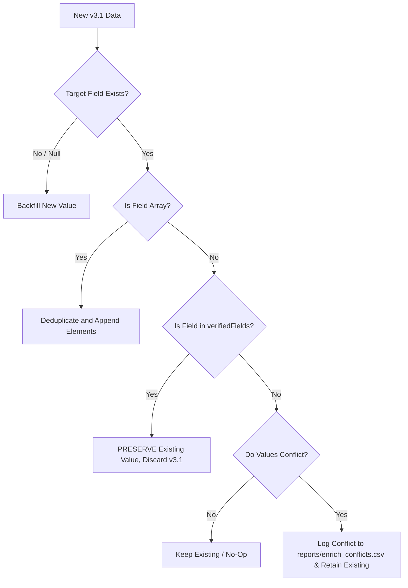

# Catalog Data Migration Specification: v3.1 Schema to MSS Catalog

**Document Version:** 1.0.0  
**Migration Target Release:** `1.35.0-alpha` (Current: `1.34.3-alpha`)  
**Target Branch:** `data/catalog-v3-1-migration`  
**Generated Date:** 2026-10-04  
**Pipeline Author:** Antigravity Migration Agent  

---

## 1. Executive Summary & Purpose

This document specifies the exact mapping, transformation rules, and non-destructive merge semantics for ingesting and reconciling Government of India scheme data from the **v3.1 dataset** (`msme_schemes_v3_1.json`, 393 records, and `new_schemes_2025_26.json`, 114 records) into the **MSS App Scheme Catalog**.

### System Architecture Constraints
1. **Catalog Database:** PostgreSQL (Supabase schema `catalog`, tables `scheme`, `relationships`, `applicability_matrix`, `search_index`, `entity_registry`).
2. **Offline Bundle:** Gzip JSON bundle downloaded by the Flutter client containing all published schemes, relationships, and metadata.
3. **Database Schema Stability:** No columns are added to PostgreSQL catalog tables (in particular, `catalog.scheme` has 20 columns and **no `name_hi` column**; all Hindi and multilingual text resides within `record_json.localization.hi.*`).
4. **Non-Destructive Enforcement:** Under `ENRICH_EXISTING`, human-verified data (`verifiedFields`, higher-tier sources) is never overwritten. Empty/null fields are backfilled; arrays are deduplicated and appended; conflicts are routed to an audit report.

---

## 2. Relational vs JSON Document Storage

The scheme catalog follows a hybrid storage pattern:
- **`catalog.scheme` (Relational Columns):** Extracts high-frequency filter attributes (`id`, `code`, `name_en`, `slug`, `scheme_type`, `category`, `status`, `target_beneficiaries`, `min_loan_inr`, `max_loan_inr`, `min_grant_inr`, `max_grant_inr`, `nodal_ministry_code`, `record_json`).
- **`record_json` (Normalized JSONB Document):** The full canonical representation conforming to `scheme_schema.json`, providing nested eligibility, detailed structured benefits, application steps, multi-tier provenance, localization, and search metadata.
- **`catalog.applicability_matrix`:** Denormalized multidimensional eligibility vectors for high-performance SQL matching against user profiles.
- **`catalog.relationships`:** Bidirectional graph edges (e.g. `administered_by`, `child_of` / `parent_of`, `associated_with`).
- **`catalog.search_index`:** Multilingual search tokens and phonetic/alias weights across EN and HI.

---

## 3. Field-by-Field Mapping Specification

The table below defines every source field present in `msme_schemes_v3_1.schema.json` and its transformation to `catalog.scheme` columns and `record_json` paths.

| v3.1 Source Field | Type | Target `record_json` Path | Target `catalog.scheme` Column | Transformation Rule | Missing / Null Handling | ENRICH_EXISTING Policy |
| :--- | :--- | :--- | :--- | :--- | :--- | :--- |
| `id` / `source_code` | string | `identity.legacyCodes[]` | — | Push `{system: "mss_v3_1", code: <v3_1_id>}` | Must be present in source | Append to array if not already present |
| Allocated Catalog ID | string | `identity.id`, `identity.code` | `id`, `code` | Format `SCH000xxx` (Phase 4 allocates `SCH000220`+) | Generated | Immutable. Preserves existing catalog `id` |
| `name` / `title.en` | string | `identity.name`, `identity.fullName`, `localization.en.name` | `name_en` | Trim whitespace; title case if raw uppercase | Keep existing if null | Only fills if existing `name` is blank. Never overwrites human-verified title |
| `short_name` / `acronym` | string | `identity.shortName`, `localization.en.shortName` | — | Extracted or parsed from parentheses e.g. `(MCGS-MSME)` | Set `null` | Fills if existing is `null` |
| Generated Slug | string | `identity.slug` | `slug` | `kebab-case(lower(name))` | Generated | Keep existing slug to prevent breaking deep links |
| Status | string | `identity.status` | `status` | Normalized to `'active'`, `'closed'`, `'merged'`, `'archived'` | Defaults to `'active'` | Updated per `02_catalog_corrections.csv` |
| `description` / `objective` | string | `content.overview.description`, `content.overview.summary`, `localization.en.description` | `description_en` | Clean whitespace, sentence split into objectives | Keep existing if null | Append to description or fill if existing summary is empty |
| `objectives` | list[str] | `content.overview.objectives[]` | — | Trim lines, strip leading bullets | Empty array `[]` | Set-union append with existing objectives |
| `nodal_ministry` | string / dict | `classification.government.ministryText`, `classification.government.ministryId` | `nodal_ministry_code` | Map to canonical Authority ID (e.g. `AUTH000003` for Ministry of MSME, `AUTH000009` for MoF) | Default `'AUTH000003'` if unmapped | Fills if null; does not overwrite existing authority reference |
| `implementing_agency` | string / dict | `classification.government.departmentText` | — | Organization string (e.g. KVIC, Coir Board, SIDBI, NSIC) | Set `null` | Fills if null |
| `scheme_type` / `category` | string | `classification.schemeType`, `classification.category` | `scheme_type`, `category` | Mapped to enum (`credit_guarantee`, `capital_subsidy`, `interest_subvention`, `grant`, `capacity_building`, `infrastructure`, etc.) | Default `'financial_support'` | Fills if existing is generic or null |
| `tags` / `keywords` | list[str] | `classification.tags[]`, `search.keywords.en[]` | `tags` (text[]) | Lowercase, snake_case tokenization | Empty list `[]` | Set-union append (deduplicated) |
| `eligibility_criteria` | list[str] | `content.eligibility.narrative.criteria[]`, `localization.en.eligibilityText` | — | Plain text bullet points extracted from booklet | Empty list `[]` | Append newly discovered criteria not present in existing |
| `target_beneficiaries` | list[str] | `content.eligibility.structured.enterprise.types[]` | `target_beneficiaries` (text[]) | Mapped to `['micro', 'small', 'medium', 'individual', 'women', 'sc_st']` | Default `['micro', 'small']` | Set-union append |
| `sectors` | list[str] | `content.eligibility.structured.sector.included[]` | — | Normalized to `['manufacturing', 'services', 'trading', 'export', 'khadi_village']` | Default all | Set-union append |
| `max_grant_amount` | string/num | `content.benefits.grant.maxAmountInr`, `content.benefits.grant.amountInr` | `max_grant_inr` | Parsed to integer INR (e.g. `"15 lakh"` -> `1500000`, `"1.5 crore"` -> `15000000`). Formatted string to `maxAmountText` | `null` | Fills if existing is null. If conflict, logged to report |
| `max_loan_amount` | string/num | `content.benefits.loan.maxAmountInr` | `max_loan_inr` | Parsed to integer INR. Text representation to `maxAmountText` | `null` | Fills if existing is null. Never lowers existing verified amount |
| `subsidy_percentage` | string/num | `content.benefits.capitalSubsidy.percentage` | — | Extracted float (e.g. `"15%"` -> `15.0`) | `null` | Fills if existing is null |
| `interest_subvention` | string/num | `content.benefits.interestSubvention.percentage` | — | Extracted float (e.g. `"8%"` -> `8.0`) | `null` | Fills if existing is null |
| `guarantee_coverage` | string/num | `content.benefits.guarantee.percentage`, `content.benefits.guarantee.maxCoverInr` | — | Extracted float coverage percentage and integer max cover INR | `null` | Fills if existing is null |
| `application_process` | list[str] / text | `content.applicationProcess.steps[]`, `localization.en.applicationText` | — | Sequential application instructions with online/offline indicators | Empty list `[]` | Fills if existing application steps are empty |
| `scheme_url` / `portal` | string | `content.schemeUrl`, `content.sources[]` | `scheme_url` | Normalized HTTPS URL. Added to sources array with type `'official_portal'` | `null` | Fills if existing is null or dead link |
| `name_hi` / `title.hi` | string | `localization.hi.name`, `search.aliases.hi[]` | — *(Stored in `record_json`, no column in `catalog.scheme`)* | Clean UTF-8 Devanagari string | `null` | Fills `localization.hi.name` if currently null |
| `summary_hi` / `desc_hi` | string | `localization.hi.summary`, `localization.hi.description` | — *(Stored in `record_json`)* | Clean UTF-8 Devanagari string | `null` | Fills `localization.hi` fields if currently null |
| `parent_scheme` | string | `relationships.references[]` | — | Inserts `{entityId: <parent_id>, entityType: "scheme", relationType: "child_of"}` into `record_json` and `catalog.relationships` | `null` | Creates parent-child edge if not already present |

---

## 4. Non-Destructive Merge Specification (`ENRICH_EXISTING`)

When enriching an existing scheme (action `ENRICH_EXISTING`), the enrichment pipeline (`scripts/catalog_v3_1/enricher.py`) follows strict non-destructive merge rules:



### Specific Field Merge Rules:
1. **`identity`**:
   - `id`, `code`, `slug` are **immutable**.
   - `legacyCodes`: Appends `{system: "mss_v3_1", code: "<source_id>"}` if not already listed.
2. **`content.benefits`**:
   - If an existing benefit (e.g. `loan`) exists, conditions from v3.1 are appended to `conditions[]`.
   - If an existing monetary amount is null/zero, the v3.1 parsed integer INR is inserted.
   - If an existing monetary amount is already present and differs from v3.1, the existing value is **preserved** and logged to `reports/enrich_conflicts.csv`.
3. **`content.applicationProcess`**:
   - If existing steps are empty (`[]`), steps from v3.1 booklet are populated.
4. **`localization.hi` (Hindi Backfill)**:
   - Populates `name`, `summary`, `description`, `objective`, `eligibilityText`, `benefitsText`, `applicationText`.
   - Never overwrites existing non-null Hindi text unless explicitly flagged for correction.
5. **`provenance` and `verification`**:
   - Existing `verifiedFields` are **never removed or modified**.
   - A transformation note is appended: `"Enriched from mss_scheme_data_v3_1 (ID: <v3_1_id>)"`.
   - `provenance.translations.hi` metadata is set to `{status: "machine", reviewRequired: true, source: "booklet_2025_26_machine_hi"}`.
6. **`metadata`**:
   - `catalogVersion` is bumped to `"1.35.0-alpha"`.
   - `revision` is incremented by 1.
   - `updatedAt` is updated to current UTC timestamp.

---

## 5. Multi-Language / Localization Architecture

### English (`en`)
- Primary operational language. All fields in `identity`, `classification`, and `content` are in English.
- Mirrored in `localization.en.*` for unified UI accessors.

### Hindi (`hi`)
- **No Table Column:** Verified in Phase 0 that `catalog.scheme` has **no `name_hi` column**. All Hindi data is stored within `record_json.localization.hi`.
- **Search Support:** Hindi scheme names and aliases are indexed into `record_json.search.aliases.hi` and denormalized into `catalog.search_index` (with `language = 'hi'`) for Hindi-script search matching.

### Tamil (`ta`)
- `localization.ta` fields remain `null` or empty where uncurated.
- **Client-Side Fallback Behavior:** Verified in Phase 0 audit that the Flutter client gracefully falls back to English when Tamil strings are null via `scheme_adapter_text_utils.dart` and `mss_entity.dart#L41-L60`:
  ```dart
  String localizedName(String lang) {
    if (lang == 'ta' && (localization?.ta?.name?.isNotEmpty ?? false)) {
      return localization!.ta!.name!;
    }
    if (lang == 'hi' && (localization?.hi?.name?.isNotEmpty ?? false)) {
      return localization!.hi!.name!;
    }
    return identity.name; // English default
  }
  ```

---

## 6. Graph Relationships & Relational Table Sync

For every record processed (whether `ADD_NEW`, `ADD_CHILD`, or `ENRICH_EXISTING`), the migration synchronizes relational tables:

1. **`catalog.relationships` Table**:
   - Column `relationship_type` (verified in Phase 0; not `relation_type`).
   - Ministry reference: `(source_scheme_id, ministry_id, 'administered_by')`.
   - Parent-child reference: Bidirectional pairs:
     - `(child_id, parent_id, 'child_of')`
     - `(parent_id, child_id, 'parent_of')`
   - Associated scheme reference: Bidirectional `associated_with` pairs.
2. **`catalog.applicability_matrix` Table**:
   - Exactly 1 row per scheme.
   - Columns: `scheme_id`, `state_ut`, `target_audience`, `enterprise_type`, `caste_category`, `gender`, `min_turnover_inr`, `max_turnover_inr`, `min_investment_inr`, `max_investment_inr`, `interest_subvention_pct`, `subsidy_pct`, `grant_amount_inr`, `loan_amount_inr`, `raw_record`.
3. **`catalog.entity_registry` Table**:
   - Tracks all system entity IDs (`scheme`, `authority`, `service`, `document`).
   - For `SCH000220` (previously marked `is_deleted = true`), the sync updates `is_deleted = false` and recomputes the SHA-256 checksum.

---

## 7. Concrete Mapped Examples

Full validated JSON files are saved in `reports/` for review:

1. **`ADD_NEW` Example:**
   - Source: `new_schemes_2025_26.json` (ID: `NEW2026-001`, Mutual Credit Guarantee Scheme for MSMEs - MCGS-MSME)
   - Allocated ID: `SCH000220`
   - Artifact: [reports/example_ADD_NEW_NEW2026-001.json](file:///c:/development/MSS%20App/MSS_App/reports/example_ADD_NEW_NEW2026-001.json)
   - Highlights: 60% guarantee up to ₹100 crore, exporter window ₹20 crore, NCGTC authority mapping (`AUTH000009`), full Hindi backfill.

2. **`ADD_CHILD` Example:**
   - Source: `msme_schemes_v3_1.json` (ID: `MSME2526-002`, 2nd Loan for Upgradation of existing PMEGP/REGP/MUDRA units)
   - Allocated ID: `SCH000221`
   - Parent ID: `SCH000130` (Prime Minister Employment Generation Programme - PMEGP)
   - Artifact: [reports/example_ADD_CHILD_MSME2526-002.json](file:///c:/development/MSS%20App/MSS_App/reports/example_ADD_CHILD_MSME2526-002.json)
   - Highlights: Bidirectional `child_of` relationship to `SCH000130`, KVIC authority mapping (`AUTH000003`), capital subsidy and term loan structuring.

3. **`ENRICH_EXISTING` Diff Example:**
   - Target Scheme: `SCH000124` (PM Vishwakarma Scheme)
   - Source: `MSME2526-078`
   - Artifact Diff: [reports/example_ENRICH_EXISTING_diff_SCH000124.json](file:///c:/development/MSS%20App/MSS_App/reports/example_ENRICH_EXISTING_diff_SCH000124.json)
   - Complete Mapped Document: [reports/example_ENRICH_EXISTING_SCH000124.json](file:///c:/development/MSS%20App/MSS_App/reports/example_ENRICH_EXISTING_SCH000124.json)
   - Highlights:
     - 0 conflicts detected.
     - Preserved all 17 existing `verifiedFields`.
     - Enriched toolkit incentive grant (₹15,000 via e-voucher).
     - Appended loan conditions ("Second tranche, collateral free, 30 months tenure, 5% interest").
     - Enriched interest subvention (8%).
     - Backfilled Hindi localization (`localization.hi.*`).
     - Appended legacy code (`MSME2526-078`) and official booklet source.
