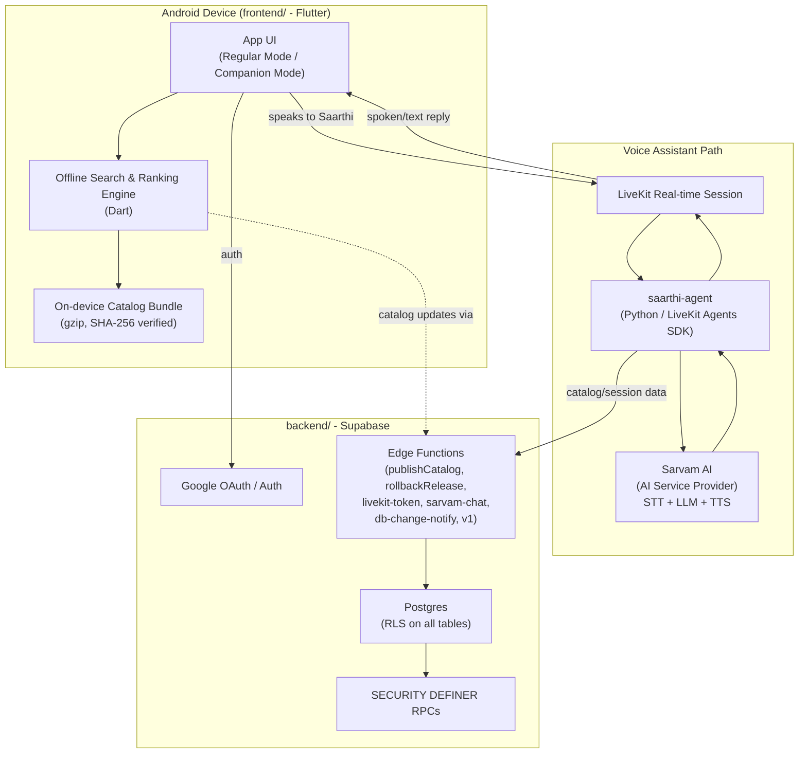
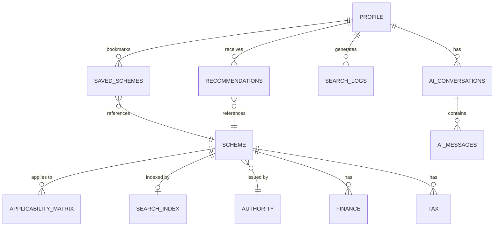

# MSS — Software Development Document

**Product name:** MSS (Government Scheme Discovery & Eligibility Platform)
**Document version:** 1.0
**Date:** 2026-09-15
**Prepared for:** MSS project team and institutional stakeholders (RIT, SSS TN Chapter)

### Revision History

| Version | Date | Author | Change |
|---|---|---|---|
| 1.0 | 2026-09-15 | Claude (AI assistant), reviewed by project owner | Initial Software Development Document created |

---

## Table of Contents

1. [Introduction / Purpose](#1-introduction--purpose)
2. [Project Overview](#2-project-overview)
3. [Scope](#3-scope)
4. [Requirements](#4-requirements)
5. [System Design](#5-system-design)
6. [Data Model](#6-data-model)
7. [Development Plan](#7-development-plan)
8. [Testing & Quality Assurance](#8-testing--quality-assurance)
9. [Deployment (Current State)](#9-deployment-current-state)
10. [Glossary](#10-glossary)
11. [Reference Index](#11-reference-index)

---

## 1. Introduction / Purpose

This document is a single reference describing what MSS is, who it is for, what it is required to do, how it is architected, and what has been built so far. It is intended for developers joining the project, reviewers, and the partner institutions, so that the project's scope, design, and current state are understood without needing to read through the full set of individual specification files in `docs/`.

This document reflects the repository as restructured in September 2026 (see `docs/archive/RESTRUCTURE_LOG.md`). `AGENTS.md` is the canonical day-to-day developer guidance file; `CLAUDE.md` is now only a pointer to it.

---

## 2. Project Overview

**What MSS is:** MSS is a bilingual (English/Tamil), offline-first Android application that helps users discover Central and State Government schemes, check their eligibility, and get guidance on the application process. It includes an AI-powered voice assistant, **Saarthi**, for users who prefer speaking over typing/reading. The in-app tagline is "Government Scheme Discovery & Eligibility Platform."

**Who has built it:** Per the application's own About screen (`frontend/lib/screens/profile/profile_about_dialog.dart`), MSS is developed in collaboration with:

- **Rajalakshmi Institute of Technology (RIT)**
- **Swadeshi Shodh Sansthan (SSS TN Chapter)**

Support contact: `mssschemessearch@gmail.com`.

**Who benefits (beneficiaries):** MSS is designed for:

- Indian entrepreneurs and MSMEs (Micro, Small & Medium Enterprises)
- Women
- Farmers
- Students
- More broadly, citizens of Tamil Nadu seeking awareness of and access to government welfare/business schemes

The app offers two experience modes to reach different beneficiary groups:

- **Regular Mode** — for users comfortable navigating search and filters directly.
- **Companion Mode** — a simplified, guided experience built for seniors, non-tech-savvy users, and rural entrepreneurs who need more assistance discovering and understanding schemes.

---

## 3. Scope

**In scope:**
- A native Android mobile application (Flutter) for scheme discovery, eligibility matching, and guidance.
- Fully offline scheme search/browse/recommendation using an on-device catalog bundle.
- Bilingual UI and content (English and Tamil).
- An AI voice assistant ("Saarthi") for conversational scheme discovery, powered by **Sarvam AI**.
- A Supabase-backed system for catalog data management, authentication, and admin/staff operations.

**Out of scope for this document / current build:**
- iOS and Web application builds. Some older docs (`README.md`, `docs/UI_UX_DESIGN_SYSTEM.md`) describe Flutter as "multi-platform (Android, iOS, Web)" and a `docs/web-handoff/` design handoff exists, but active development, testing (`AGENTS.md`), and the release plan (Play Store) are all Android-only. This document treats Android as the sole target platform; iOS/Web material elsewhere in the repo should be read as legacy/undecided, not part of current requirements.

---

## 4. Requirements

### 4.1 Platform Requirement
- **Android only.** Distribution target is the Google Play Store. No iOS or Web release is part of the current requirement set.

### 4.2 Functional Requirements
- Search and browse government schemes (Central and State).
- Eligibility matching against user profile attributes.
- Bilingual (English/Tamil) content and interface.
- Fully offline scheme discovery — no network dependency for core search/browse.
- AI voice assistant ("Saarthi") for conversational, spoken interaction with the scheme catalog, powered by **Sarvam AI**.
- User profile management supporting both Regular Mode and Companion Mode.
- Notifications (e.g. new/updated schemes, catalog updates).
- Catalog update mechanism with integrity verification (SHA-256) and rollback support.

### 4.3 Non-Functional Requirements
- **Offline capability:** 100% of core discovery functionality (search, browse, ranking) must work without a network connection.
- **Performance:** Must run acceptably on low-end Android devices — this is an explicit testing target (`AGENTS.md`).
- **Data integrity:** Catalog bundles are SHA-256 verified before use.
- **Security:** Backend enforces Row-Level Security (RLS) on all tables and uses `SECURITY DEFINER` RPC functions for controlled access; authentication via Google OAuth.
- **Accessibility:** Companion Mode addresses accessibility for seniors, non-tech-savvy users, and rural entrepreneurs.

### 4.4 Assumptions & Constraints
- A single Supabase backend project currently serves the app (region migration from Sydney to Mumbai is a known pending item, not yet executed).
- Deployment today is manual for the backend/Edge Functions and the voice agent; there is currently no automated build/release pipeline for the Flutter app itself.
- The server-side search endpoint (`POST /v1/search`) exists but is not currently called by any client — offline, on-device search is the only active discovery path today.

---

## 5. System Design

### 5.1 Components

| Component | Technology | Responsibility |
|---|---|---|
| `frontend/` | Flutter (Android) | User-facing app: search UI, profiles, Regular/Companion modes, offline catalog engine, voice assistant UI |
| `backend/` | Supabase (Postgres, PostgREST, Edge Functions) | Catalog data storage, authentication, RLS-secured RPCs, admin/staff operations, catalog publishing |
| `saarthi-agent/` | Python (LiveKit Agents SDK) | Voice assistant worker — handles real-time voice sessions and calls **Sarvam AI** for speech understanding and generation |
| **Sarvam AI** (external) | Third-party AI service | The project's **AI service provider** — supplies Speech-to-Text, the conversational LLM, and Text-to-Speech used by Saarthi |

### 5.2 Data Flow

**Offline discovery path (primary):**
User opens app → on-device catalog bundle (gzip, SHA-256 verified) is loaded → offline search/ranking engine runs entirely on-device → results shown in UI. No network call is required for this path.

**Voice assistance path (Saarthi):**
User speaks → LiveKit real-time session → `saarthi-agent` (Python worker) → **Sarvam AI** (Speech-to-Text → LLM conversation → Text-to-Speech) → spoken/text response returned to the user, with scheme data drawn from the shared catalog/Supabase.

**Catalog update path:**
Admin/staff publish a new catalog release via a Supabase Edge Function → new catalog bundle is SHA-256 verified and delivered to the app → app can update or roll back to a previous verified release.

### 5.3 Architecture Diagram



### 5.4 Security Model
- Row-Level Security (RLS) enforced on all Postgres tables.
- Controlled write/read access via `SECURITY DEFINER` RPC functions (`mss_*`) rather than direct table access.
- Google OAuth for user authentication.
- Catalog releases are cryptographically verified (SHA-256) before being applied on-device.

---

## 6. Data Model

The backend database (`backend/supabase/schema.sql`) uses three schemas: **`catalog`** (versioned scheme content, published via a review workflow), **`public`** (user-facing app data), and **`admin`** (staff/ops tooling — not detailed here). Below is a simplified view of the core tables involved in scheme discovery and recommendations.

### 6.1 Core Catalog Tables (schema: `catalog`)

| Table | Key columns | Purpose |
|---|---|---|
| `scheme` | `id`, `scheme_code`, `name_en`, `name_ta`, `government_level`, `ministry`, `state`, `primary_authority_id`, `status` (DRAFT→PUBLISHED→ARCHIVED), `record_json` | The core scheme record — one row per government scheme, bilingual name fields, funding range, review-workflow status |
| `authority` | `id`, `code`, `name_en`, `name_ta` | The issuing government body/ministry/department for a scheme |
| `applicability_matrix` | `scheme_id` → `scheme.id`, `government_level`, `department_authority_id`, `sector_text`, `district_text` | Defines who/where a scheme applies to (sector, district, government level) |
| `search_index` | `scheme_id` → `scheme.id`, `content`, `embedding (vector)` | Search-optimized text and embedding vector per scheme, backing the offline/server search engines |
| `entity_registry` | `entity_id`, `entity_type`, `catalog_name`, `current_version` | Tracks every published entity across all catalog tables (versioning/publishing ledger) |
| `finance`, `tax`, `treds`, `csr`, `enterprise_classification`, `business_enablement`, `cluster_assistance`, `institution`, `knowledge`, `msme_privilege` | each keyed by `scheme_id` or `id`, `status`, `record_json` | Specialized detail tables — one per scheme facet (financing terms, tax exemptions, TReDS, CSR focus areas, MSME classification thresholds, etc.) |

All `catalog.*` tables share the same versioning pattern: `id`, `version`, `status` (DRAFT/READY_FOR_REVIEW/REVIEWED/APPROVED/PUBLISHED/ARCHIVED), `checksum`, `record_json`, `updated_at`, `published_at`.

### 6.2 Core App Tables (schema: `public`)

| Table | Key columns | Purpose |
|---|---|---|
| `profiles` | `id` (→ auth user), `email`, `language`, `navigation_mode` (regular/companion), `applicant_type`, `state`, `district`, `gender`, `annual_income`, `religion`, `first_gen_graduate` | The user's profile — drives eligibility matching and Regular/Companion mode selection |
| `saved_schemes` | `user_id` → `profiles.id`, `scheme_id` → `catalog.scheme.id` | Schemes a user has bookmarked |
| `recommendations` | `startup_profile_id`, `scheme_id`, `match_score`, `recommendation_rank`, `recommendation_reason` | Generated eligibility-matched scheme recommendations per user profile |
| `search_logs` | `user_id`, `query`, `results_count` | Search query history |
| `ai_conversations` / `ai_messages` | `id`, `user_id` / `conversation_id`, `role`, `content` | Saarthi voice/chat conversation history |
| `notifications`, `promo_alerts` | — | User-facing notifications and targeted promotional alerts |

### 6.3 Entity Relationship Diagram (simplified)



*This is a simplified, illustrative diagram covering the core discovery/recommendation path — the full schema (75 migrations) includes additional `catalog.*` detail tables (per-facet scheme data) and `admin.*` operational tables not shown here. See `backend/supabase/schema.sql` for the complete, current definition.*

---

## 7. Development Plan

### 7.1 Technology Stack

| Layer | Technology |
|---|---|
| Mobile app | Flutter (SDK `^3.11.1`), Dart, Material 3, Provider (state management) |
| Backend | Supabase — Postgres, PostgREST, Deno-based Edge Functions, Row-Level Security |
| Voice agent | Python 3.12+, LiveKit Agents SDK |
| **AI service provider** | **Sarvam AI** — Speech-to-Text (`saaras:v3`), Conversational LLM (`sarvam-105b-conversations`), Text-to-Speech (`bulbul:v3`, speaker `kavitha`) |
| Auth | Google OAuth |
| CI/CD | GitHub Actions (8 workflows — see 7.4) |

### 7.2 Current File Structure (as of the September 2026 restructure)

```
MSS_App/
├── .github/            # 8 CI workflows
├── AGENTS.md           # canonical developer guidance (all AI assistants + humans)
├── CLAUDE.md           # thin pointer to AGENTS.md
├── README.md
├── backend/
│   ├── supabase/       # config, schema.sql, 75 migrations, 6 edge functions, seed/, tests/
│   ├── catalog/
│   ├── openapi/
│   └── scripts/
├── frontend/
│   ├── lib/            # config, l10n, models, providers, screens, services, utils, widgets
│   ├── android/        # Android platform project
│   └── web/            # default Flutter scaffold (not actively developed; Android is the target)
├── saarthi-agent/
│   ├── src/            # agent.py, hybrid_search.py, scheme_catalog.py, search_taxonomy.py, catalog_sync.py
│   ├── tests/
│   └── data/
├── docs/               # this document, architecture/spec/runbook docs, archive/
└── tools/
```

*Note: this structure reflects the Sept 2026 docs/code restructure and may drift over time — verify against the live repo before relying on exact paths.*

### 7.3 What Has Been Built So Far
- Fully offline catalog engine and hybrid search, with the same ranking algorithm implemented in parity-locked **Dart, TypeScript, and Python** runtimes.
- Regular Mode and Companion Mode user experiences.
- 75 forward-only database migrations across `public`/`catalog`/`admin`/`private` schemas.
- 6 Supabase Edge Functions: `v1`, `livekit-token`, `publishCatalog`, `rollbackRelease`, `sarvam-chat`, `db-change-notify`.
- 480+ Flutter tests, plus search-engine parity tests and backend database tests.
- Admin/staff role-based access control (RBAC) foundation.
- Saarthi voice assistant integrated end-to-end with **Sarvam AI** for STT, conversational LLM, and TTS.
- Offline catalog bundle: 219 schemes, SHA-256 verified, with OTA update and rollback support.

### 7.4 CI/CD (GitHub Actions)
Eight active workflows cover: backend database checks, app build, Edge Function deployment, voice agent deployment, RLS drift checking, URL health checking, dev log automation, and saarthi-agent CI. There is currently no automated build/signing/release pipeline for the Flutter Android app itself — this remains a manual step today.

---

## 8. Testing & Quality Assurance
- **Frontend:** 480+ Flutter tests.
- **Search engine:** Parity tests ensuring identical ranking behavior across the Dart, TypeScript, and Python implementations.
- **Backend:** Database-level tests under `backend/supabase/tests/database/`.
- **Device testing:** Explicit practice of testing on a representative low-end Android device/emulator to validate performance.

---

## 9. Deployment (Current State)
- Single Supabase backend project (current region: Sydney `ap-southeast-2`).
- Edge Functions and database migrations are deployed via existing GitHub Actions workflows.
- The voice agent (`saarthi-agent`) is deployed via its own GitHub Actions workflow, connecting to LiveKit Cloud.
- The Android app's distribution target is the Google Play Store; app build/signing/release is currently a manual process.

*A small number of items remain open at the time of writing — a staging Supabase environment, an automated Flutter release pipeline, and a pending Supabase region migration — tracked in `docs/DEPLOYMENT_ARCHITECTURE.md`.*

---

## 10. Glossary

| Term | Meaning |
|---|---|
| **MSS** | The project name; the app itself ("Government Scheme Discovery & Eligibility Platform"). |
| **Saarthi** | The in-app AI voice assistant. |
| **Sarvam AI** | The third-party AI service provider supplying Speech-to-Text, the conversational LLM, and Text-to-Speech capabilities used by Saarthi. |
| **RLS** | Row-Level Security — a Postgres feature restricting which rows a query can see/modify based on policy. |
| **Edge Function** | A Supabase-hosted serverless function (Deno runtime) used for backend logic such as catalog publishing. |
| **Companion Mode** | A simplified app experience designed for seniors, non-tech-savvy users, and rural entrepreneurs. |
| **Regular Mode** | The standard app experience for users comfortable with direct search/filtering. |

---

## 11. Reference Index

For deeper detail beyond this document, see:

- `AGENTS.md` — canonical developer guidance, commands, and architecture invariants.
- `docs/DEPLOYMENT_ARCHITECTURE.md` — deployment topology and open infrastructure items.
- `docs/OFFLINE_DISCOVERY_AND_SEARCH_ARCHITECTURE.md` — search/ranking algorithm detail.
- `docs/backend/BACKEND_SPECIFICATION.md` — backend/database specification.
- `docs/specs/CATALOG_SPECIFICATIONS.md` — scheme catalog data specification.
- `docs/runbooks/OPERATIONS_RUNBOOK.md` — operational procedures.
- `docs/archive/RESTRUCTURE_LOG.md` — record of the September 2026 repository restructure.
