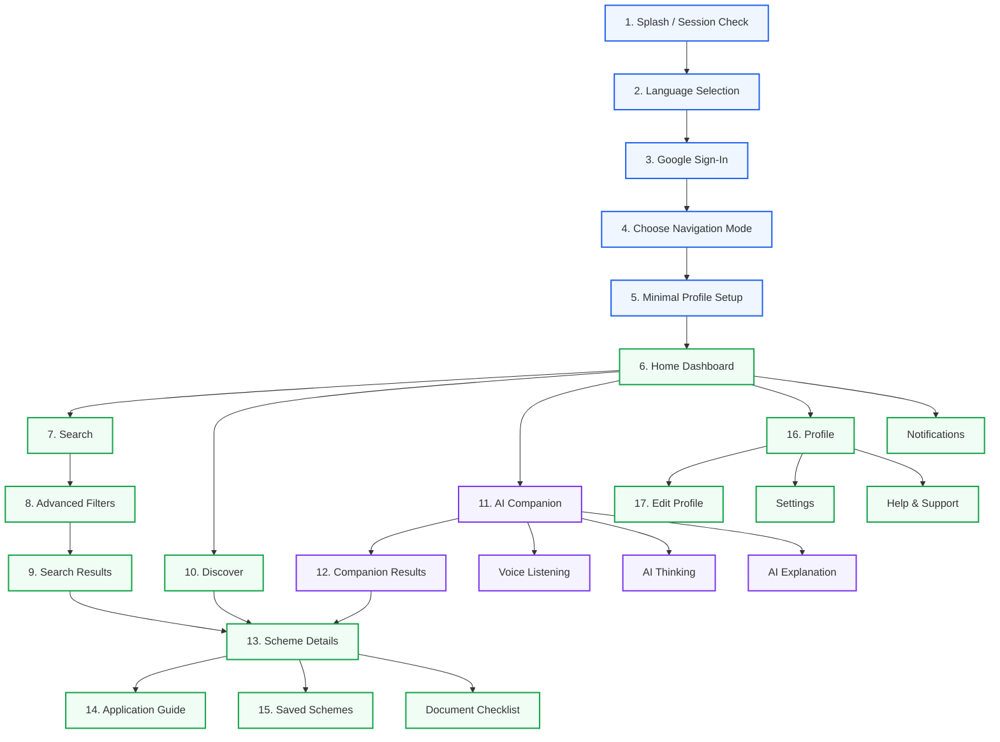

# UX Flow — user journeys, adapted for the web

Source: `docs/UI_UX_DESIGN_SYSTEM.md` Part 2 ("UX Architecture, Screen Flow & User Journeys") in the main repo. That doc is **design intent**, not independently re-verified against the running code the way 04-FEATURE-INVENTORY.md was — it documents a few things not yet built (Hindi/Telugu/Kannada/Malayalam are listed as "planned/future," conversation "Reviews & Community Feedback" is marked "future phase"). Treat those as roadmap, not current scope.

## Visual journey (Mermaid, adapted from the source doc)

Numbers match the section headers below. Colors: blue = onboarding, green = main app, purple = AI companion.

## Flow-by-flow, with the route it maps to (05-ROUTING-MAP.md)

### 1. Onboarding (`app/(auth)/*`, `app/onboarding/*`)
Splash → language → Google sign-in → navigation-mode choice → 4-step profile wizard. On the web, splash/session-check is just the root layout's auth guard (no animated native splash screen needed) — see 04-FEATURE-INVENTORY.md's auth flow for the actual session-resolution logic to replicate, and note the browser-OAuth simplification called out there (no deep-link race, no `isOAuthPending` polling).

### 2. Home → Search (`app/(main)/page.tsx` → `app/(main)/search/page.tsx`)
Home's search bar and quick-pill chips route to `/search?q=...`. Advanced filters open as a panel (modal/drawer on web, was a bottom sheet on mobile) scoped to the *current* search results, not the whole catalog — this is bug #3 from the mobile QA pass (docs/audit/AUDIT.md), so get the scoping right from day one on the web rather than reproducing it.

### 3. Search → Results → Details (`/search` → `/scheme/[id]`)
Results list shows match score, sort controls, active filter chips, infinite scroll. Tapping a result goes to `/scheme/[id]`, which is a tabbed detail page (Overview/Benefits/Eligibility/Documents/Services/Process per 04-FEATURE-INVENTORY.md) — "Amazon-style" per the source doc: hero banner, match-score explainability box, footer actions (Save / Share / Apply Now).

### 4. Discover (`/discover`, `/discover/category|ministry|state/[slug]`)
Segmented browsing, not a flat list: trending/new, target-demographic groups (women, students, senior citizens, agriculture), business verticals (startups, skill development), welfare areas (healthcare, housing), plus browse-by-ministry and browse-by-state. This is pure catalog filtering — no search-ranking call needed (see 06-API-CONTRACT.md's call-budget strategy).

### 5. AI Companion (`/companion`, `/chat`)
Voice + text conversational interface with quick-suggestion prompts and a confidence-scored, explained recommendation view ("why these schemes match"). **Out of scope for the initial web port** per the README — LiveKit voice UI is a distinct, larger effort. If/when it's built, it hangs off `/companion` per 05-ROUTING-MAP.md.

### 6. Saved (`/saved`)
Bookmarked schemes; the source doc also lists "Downloaded" (offline-cached documents) and "Recently Viewed" tabs — a website doesn't need true offline document caching the way the mobile app might, but "recently viewed" is a reasonable, easy addition (session-scoped or persisted per-user).

### 7. Profile & Settings (`/profile`, `/profile/settings`)
Profile hub links to edit-profile forms (grouped: personal/location, occupation/education, income/community, business details), language preference, navigation-mode selector, saved schemes, settings, support, logout. The source doc also describes a **progressive profile-completion wizard** (prompts for one missing attribute at a time — income, then community, then disability, etc. — rather than a big form) as a *distinct* flow from the main edit-profile form; worth keeping distinct on web too, since it serves a different moment (light nudge vs. deliberate edit).

### 8. Notifications (`/notifications`)
Segmented feed: new schemes matching the user's profile, deadline reminders, department/policy updates, system alerts (e.g. profile-completion nudges).

## Utility/edge states to design for (not full screens, but recurring UI states across the app)

- Empty states (no search results, no saved schemes, etc.)
- Offline / no-internet state — the mobile app has a dedicated "no internet" dialog on the splash/auth path (see `splash_screen.dart`'s `_showNoNetworkDialog` in 04-FEATURE-INVENTORY.md's source); a web equivalent matters less for search (which the site can't do offline anyway per 06-API-CONTRACT.md) but still matters for auth/session checks.
- Inline error states & confirmation dialogs
- Loading skeletons (not spinners) for card lists, matching the "instant, deterministic" feel documented in 03-SEARCH-ALGORITHM.md
- Permission requests — mobile-only (location, notifications); largely N/A for an initial web port beyond the standard browser geolocation prompt if "use my location" is kept as a feature.
